<!-- ARQUIVO GERADO por docs/diagramas/gerar.mjs — não edite à mão; altere o código-fonte e rode `npm run gerar`. -->

# Diagramas da Produção Técnica gerados do código (Bloco P1)

Este índice reúne 34 diagramas dos itens #3, #7, #8, #9, #16, #17, #22, #23, #24, #26, #27, #28 do checklist. Todos são gerados por `docs/diagramas/gerar.mjs` a partir do código-fonte; as figuras em PNG ficam em `docs/producao-tecnica/figuras/` e as fontes Mermaid em `docs/diagramas/fontes/`.

Base da geração: 27 tabelas, 33 rotas (30 telas distintas), 65 endpoints e 91 transições entre telas lidas do código.

## Como regenerar

```bash
cd backend && npm install && npm run docs:modelo      # exporta o modelo do banco (schema.ts → dados/modelo.json)
cd ../docs/diagramas && npm install                   # Mermaid CLI + TypeScript
npm run gerar                                         # fontes .mmd, dados e tabelas
npm run figuras                                       # idem + PNGs (usa o Chrome ou o Edge instalado)
npm run verificar                                     # falha se algo versionado estiver desatualizado
```

Detalhes e solução de problemas: [`README.md`](README.md).

## Sumário

| Item | Assunto | Figuras |
|---|---|---|
| #3 | Sitemap | [03-sitemap-backoffice](#03-sitemap-backoffice)<br/>[03-sitemap-cliente](#03-sitemap-cliente)<br/>[03-sitemap-completo](#03-sitemap-completo)<br/>[03-sitemap-interprete](#03-sitemap-interprete)<br/>[03-sitemap-publico](#03-sitemap-publico) |
| #7 | Arquitetura funcional | [07-arquitetura-funcional](#07-arquitetura-funcional) |
| #8 | Arquitetura técnica | [08-arquitetura-tecnica](#08-arquitetura-tecnica) |
| #9 | Arquitetura MVC | [09-arquitetura-mvc](#09-arquitetura-mvc) |
| #16 | Macroprocesso | [16-macroprocesso](#16-macroprocesso) |
| #17 | Fluxograma | [17-fluxograma-1-solicitacao-e-estimativa](#17-fluxograma-1-solicitacao-e-estimativa)<br/>[17-fluxograma-2-resposta-e-aceite](#17-fluxograma-2-resposta-e-aceite)<br/>[17-fluxograma-3-encontro-e-checkin](#17-fluxograma-3-encontro-e-checkin)<br/>[17-fluxograma-4-pagamento-e-avaliacao](#17-fluxograma-4-pagamento-e-avaliacao) |
| #22 | Diagrama entidade-relacionamento | [22-der-1-identidade-e-perfis](#22-der-1-identidade-e-perfis)<br/>[22-der-2-solicitacao-cotacao-distribuicao-e-aceite](#22-der-2-solicitacao-cotacao-distribuicao-e-aceite)<br/>[22-der-3-atendimento-presencial](#22-der-3-atendimento-presencial)<br/>[22-der-4-financeiro](#22-der-4-financeiro)<br/>[22-der-5-pos-atendimento](#22-der-5-pos-atendimento)<br/>[22-der-6-privacidade-notificacoes-sessoes-e-auditoria](#22-der-6-privacidade-notificacoes-sessoes-e-auditoria)<br/>[22-der-visao-geral](#22-der-visao-geral) |
| #23 | Diagrama de estado de máquina | [23-estados-1-solicitacao](#23-estados-1-solicitacao)<br/>[23-estados-2-atendimento](#23-estados-2-atendimento)<br/>[23-estados-3-pagamento](#23-estados-3-pagamento)<br/>[23-estados-4-habilitacao](#23-estados-4-habilitacao) |
| #24 | Diagrama de operação | [24-operacao-a-aceite-exclusivo](#24-operacao-a-aceite-exclusivo)<br/>[24-operacao-b-checkin](#24-operacao-b-checkin)<br/>[24-operacao-c-encerramento](#24-operacao-c-encerramento)<br/>[24-operacao-d-pagamento-comprovante](#24-operacao-d-pagamento-comprovante) |
| #26 | Diagrama de processos (telas) | [26-telas-backoffice](#26-telas-backoffice)<br/>[26-telas-cliente](#26-telas-cliente)<br/>[26-telas-interprete](#26-telas-interprete)<br/>[26-telas-publico](#26-telas-publico) |
| #27 | Ferramenta CASE | [27-ferramenta-case](#27-ferramenta-case) |
| #28 | Diagrama de contexto | [28-diagrama-de-contexto](#28-diagrama-de-contexto) |

Tabelas de apoio (geradas dos mesmos dados): [`dicionario-de-dados.md`](../producao-tecnica/tabelas/dicionario-de-dados.md) · [`rotas-e-telas.md`](../producao-tecnica/tabelas/rotas-e-telas.md) · [`api.md`](../producao-tecnica/tabelas/api.md) · [`tecnologias.md`](../producao-tecnica/tabelas/tecnologias.md) · [`transicoes-de-telas.md`](../producao-tecnica/tabelas/transicoes-de-telas.md).

## Item #3 — Sitemap

<a id="03-sitemap-backoffice"></a>

### Sitemap — backoffice

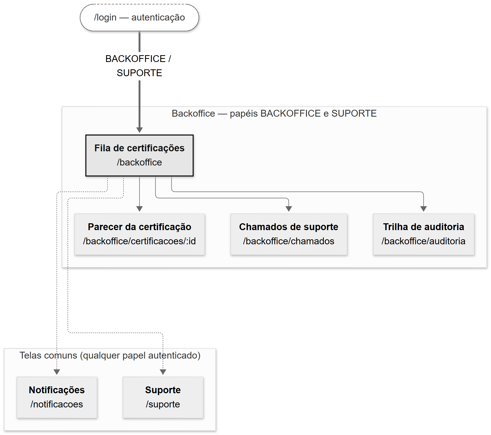

Fonte: Autoria própria apoiado por IA generativa (gerado a partir do código-fonte).

Parte do sitemap: 4 rotas de acesso por papéis BACKOFFICE e SUPORTE, mais 2 telas comuns.

<details>
<summary>Fonte Mermaid (<code>docs/diagramas/fontes/03-sitemap-backoffice.mmd</code>)</summary>

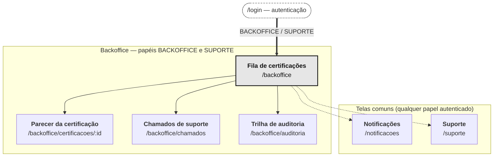

</details>

<a id="03-sitemap-cliente"></a>

### Sitemap — área do cliente

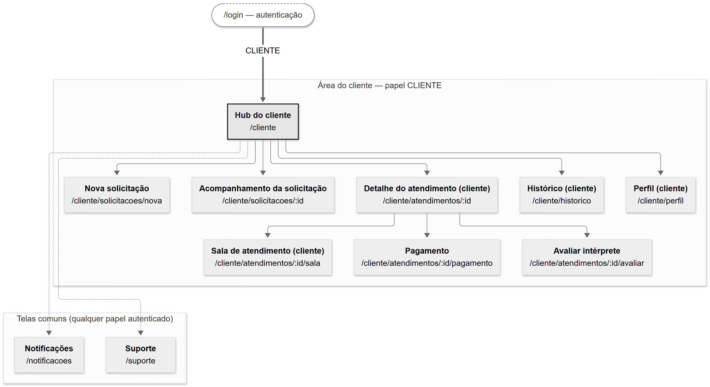

Fonte: Autoria própria apoiado por IA generativa (gerado a partir do código-fonte).

Parte do sitemap: 9 rotas de acesso por papel CLIENTE, mais 2 telas comuns.

<details>
<summary>Fonte Mermaid (<code>docs/diagramas/fontes/03-sitemap-cliente.mmd</code>)</summary>

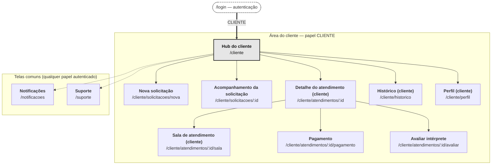

</details>

<a id="03-sitemap-completo"></a>

### Sitemap completo da aplicação

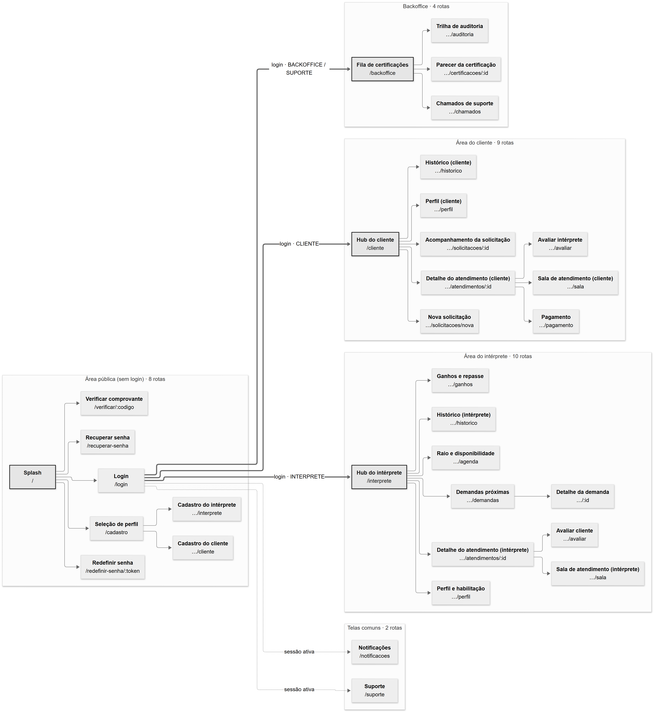

Fonte: Autoria própria apoiado por IA generativa (gerado a partir do código-fonte).

Gerado de `frontend/src/rotas.tsx`: 33 rotas (30 telas distintas) em 5 áreas. Setas finas: hierarquia de URL (a rota de destino é filha da de origem; as filhas mostram só o trecho que acrescentam ao caminho, como `…/sala`). Setas grossas: entrada na área após o login, com o papel exigido pela guarda `Protegida`. Setas tracejadas: telas comuns, acessíveis a qualquer papel com sessão ativa. Os caminhos completos estão nas figuras de cada área e em `docs/producao-tecnica/tabelas/rotas-e-telas.md`.

<details>
<summary>Fonte Mermaid (<code>docs/diagramas/fontes/03-sitemap-completo.mmd</code>)</summary>

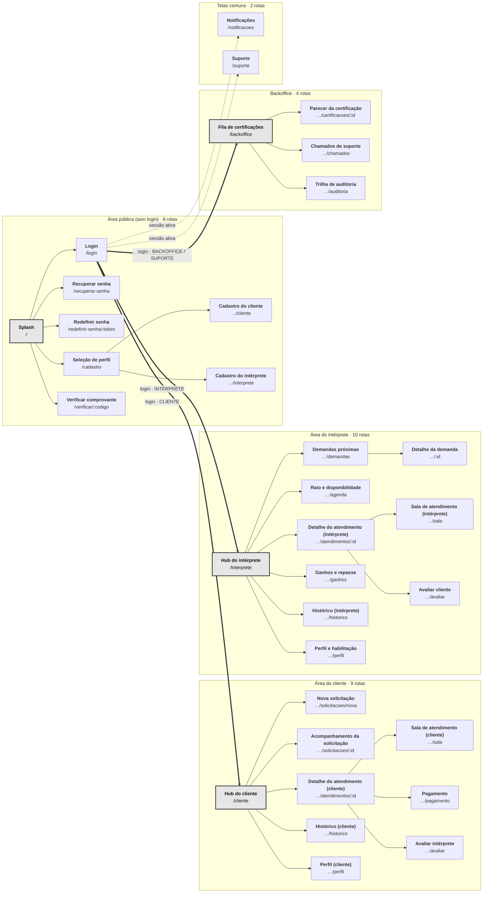

</details>

<a id="03-sitemap-interprete"></a>

### Sitemap — área do intérprete

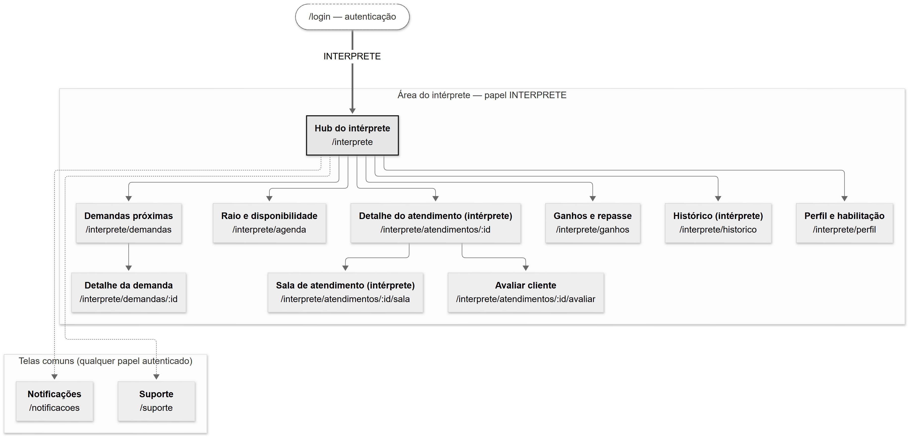

Fonte: Autoria própria apoiado por IA generativa (gerado a partir do código-fonte).

Parte do sitemap: 10 rotas de acesso por papel INTERPRETE, mais 2 telas comuns.

<details>
<summary>Fonte Mermaid (<code>docs/diagramas/fontes/03-sitemap-interprete.mmd</code>)</summary>

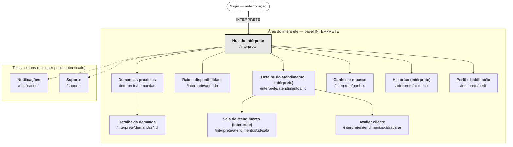

</details>

<a id="03-sitemap-publico"></a>

### Sitemap — área pública (sem login)

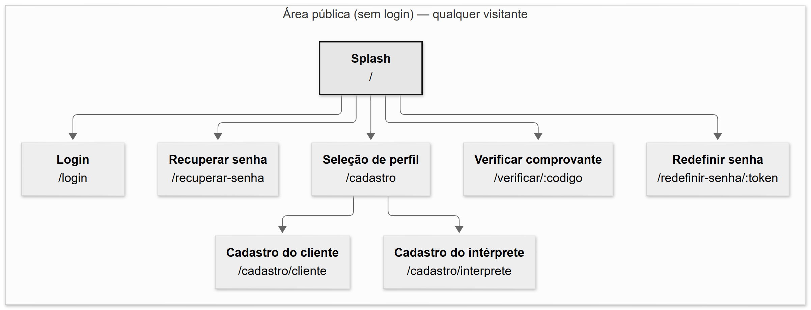

Fonte: Autoria própria apoiado por IA generativa (gerado a partir do código-fonte).

Parte do sitemap: 8 rotas de acesso por qualquer visitante.

<details>
<summary>Fonte Mermaid (<code>docs/diagramas/fontes/03-sitemap-publico.mmd</code>)</summary>

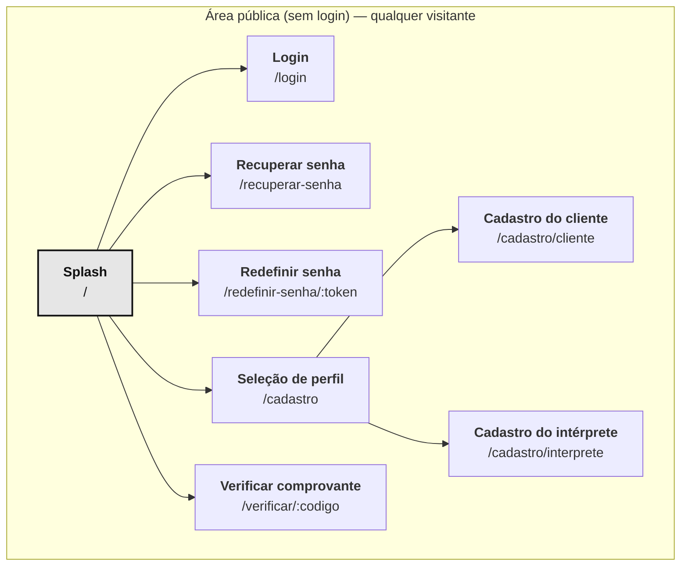

</details>

## Item #7 — Arquitetura funcional

<a id="07-arquitetura-funcional"></a>

### Arquitetura funcional

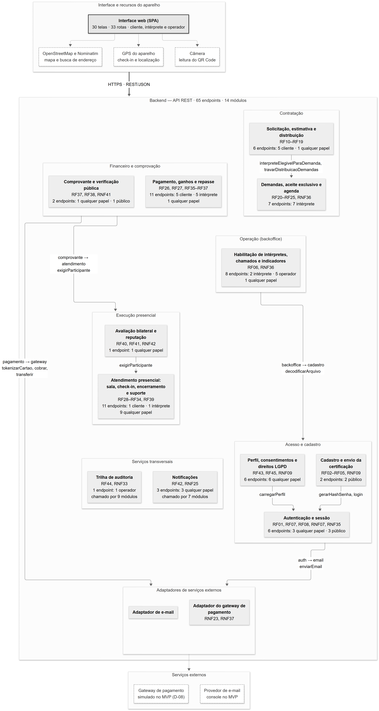

Fonte: Autoria própria apoiado por IA generativa (gerado a partir do código-fonte).

Cada caixa é um módulo de negócio do backend (um arquivo em `backend/src/services`: 14 serviços), com os requisitos declarados no cabeçalho do arquivo e o número de endpoints que o acionam (65 no total), separados pelo acesso que a rota exige em `backend/src/routes/index.ts` ("qualquer papel" = basta estar autenticado). Os módulos estão agrupados em faixas; as setas são as importações reais entre serviços — dentro da faixa, de módulo para módulo; entre faixas, rotuladas com os módulos e as funções importadas. Os serviços transversais (auditoria e notificacao) são chamados por quase todos os módulos e por isso aparecem sem setas.

<details>
<summary>Fonte Mermaid (<code>docs/diagramas/fontes/07-arquitetura-funcional.mmd</code>)</summary>

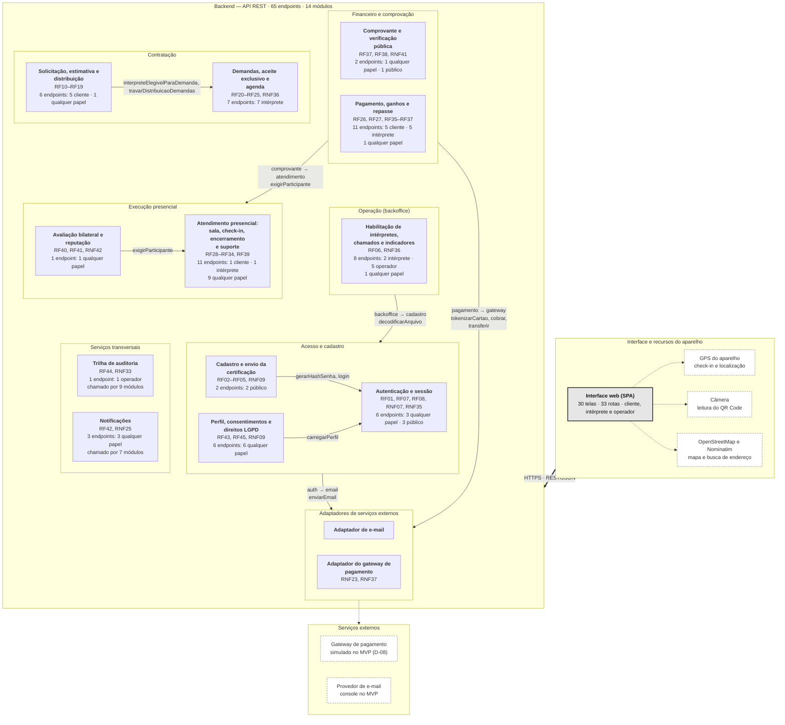

</details>

## Item #8 — Arquitetura técnica

<a id="08-arquitetura-tecnica"></a>

### Arquitetura técnica

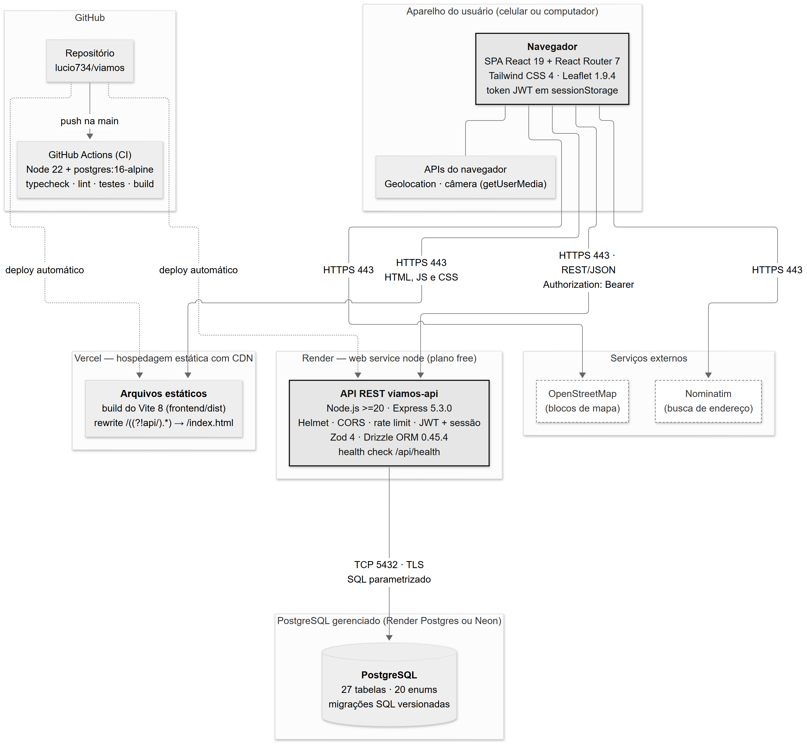

Fonte: Autoria própria apoiado por IA generativa (gerado a partir do código-fonte).

Servidores, protocolos e portas da publicação em nuvem, com as versões lidas de `package-lock.json` e as configurações lidas de `render.yaml`, `frontend/vercel.json` e `.github/workflows/ci.yml`. Em desenvolvimento local: Vite na porta 5173 (com proxy de `/api` para http://localhost:3333), API na porta 3333 e PostgreSQL na porta 5432 (`docker-compose.yml`, imagem postgres:16-alpine). A tabela de tecnologias correspondente está em `docs/producao-tecnica/tabelas/tecnologias.md`.

<details>
<summary>Fonte Mermaid (<code>docs/diagramas/fontes/08-arquitetura-tecnica.mmd</code>)</summary>

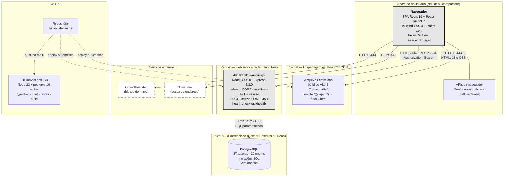

</details>

## Item #9 — Arquitetura MVC

<a id="09-arquitetura-mvc"></a>

### Arquitetura MVC e ambiente de hospedagem

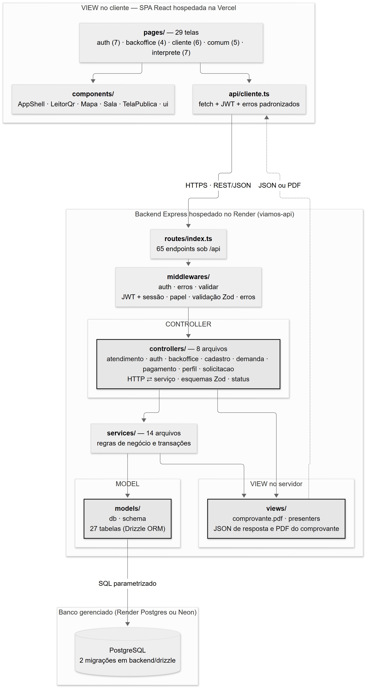

Fonte: Autoria própria apoiado por IA generativa (gerado a partir do código-fonte).

Distribuição real das pastas de `backend/src` e `frontend/src` entre Model, View e Controller, com o ambiente em que cada camada é publicada. Model: `models/` (esquema e conexão). View: `views/` no servidor (JSON e PDF) e a SPA React no cliente. Controller: `controllers/`, acionados por `routes/index.ts` depois dos `middlewares/`. As regras de negócio ficam em `services/`, entre o Controller e o Model, para que nenhum controller acesse o banco diretamente.

<details>
<summary>Fonte Mermaid (<code>docs/diagramas/fontes/09-arquitetura-mvc.mmd</code>)</summary>

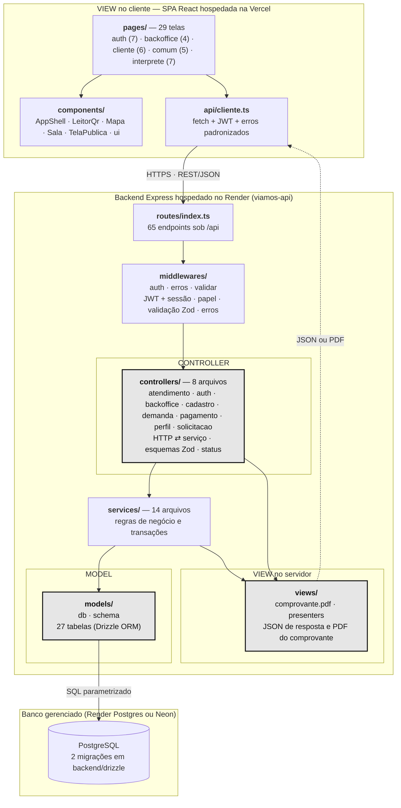

</details>

## Item #16 — Macroprocesso

<a id="16-macroprocesso"></a>

### Macroprocesso — cadeia de valor do atendimento presencial

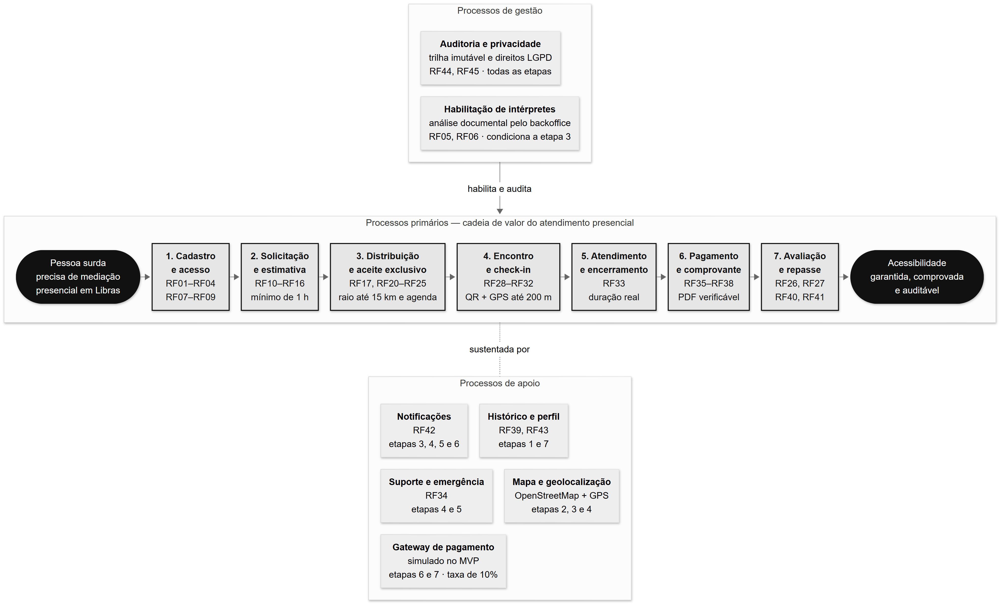

Fonte: Autoria própria apoiado por IA generativa (gerado a partir do código-fonte).

Visão sistêmica em três faixas: os sete processos primários levam da necessidade de mediação até o atendimento comprovado; acima, os processos de gestão que habilitam e auditam a cadeia; abaixo, os processos de apoio, com as etapas que cada um sustenta. Os números (duração mínima, raio, distância do check-in e taxa da plataforma) são lidos de `backend/src/config/regras.ts`.

<details>
<summary>Fonte Mermaid (<code>docs/diagramas/fontes/16-macroprocesso.mmd</code>)</summary>

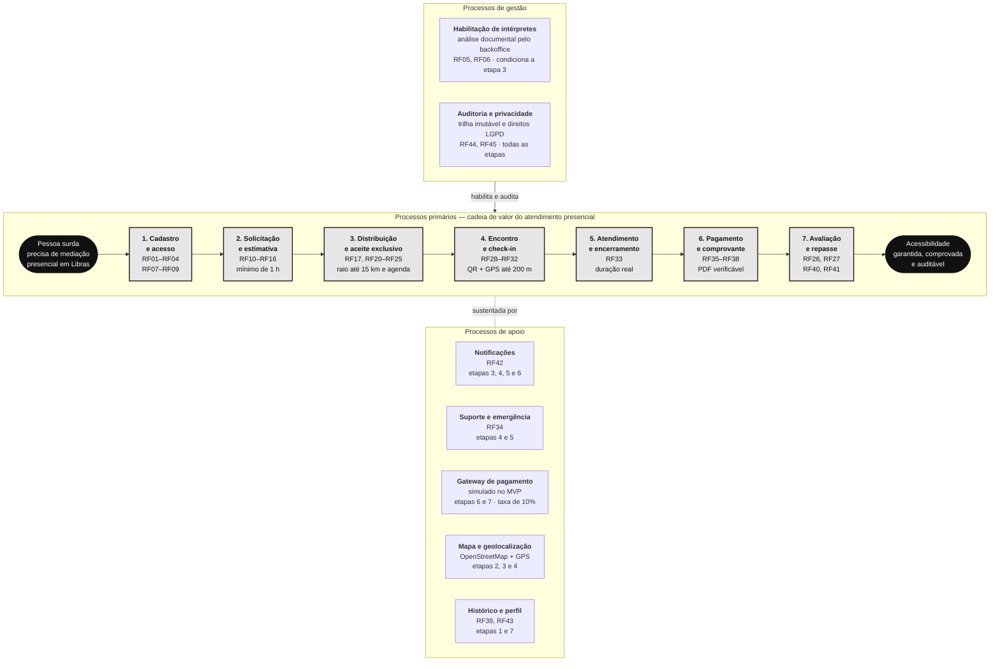

</details>

## Item #17 — Fluxograma

<a id="17-fluxograma-1-solicitacao-e-estimativa"></a>

### Fluxograma do atendimento — parte 1: solicitação, estimativa e distribuição

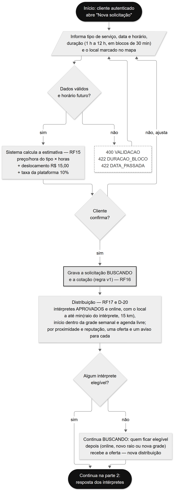

Fonte: Autoria própria apoiado por IA generativa (gerado a partir do código-fonte).

Do início até a distribuição da demanda, na ordem em que `criarSolicitacao` avalia os dados (`solicitacao.service.ts`). A distribuição usa a mesma regra de elegibilidade da lista e do aceite (D-20). As caixas tracejadas são as respostas de erro devolvidas pela API em cada desvio; todos os números vêm de `backend/src/config/regras.ts`.

<details>
<summary>Fonte Mermaid (<code>docs/diagramas/fontes/17-fluxograma-1-solicitacao-e-estimativa.mmd</code>)</summary>

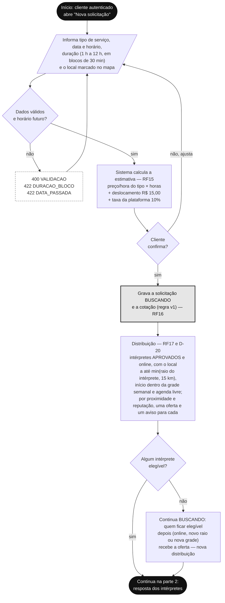

</details>

<a id="17-fluxograma-2-resposta-e-aceite"></a>

### Fluxograma do atendimento — parte 2: resposta dos intérpretes, cancelamento e aceite

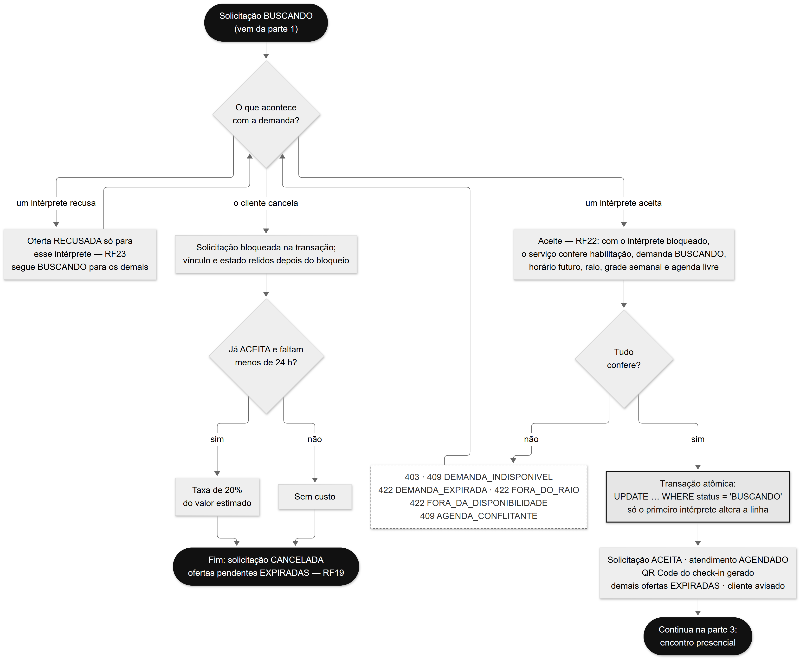

Fonte: Autoria própria apoiado por IA generativa (gerado a partir do código-fonte).

Os três desfechos de uma demanda aberta: recusa individual, cancelamento pelo cliente (com a regra de taxa, decidida depois de bloquear a solicitação) e aceite exclusivo, com o intérprete bloqueado para que dois aceites dele não ocupem o mesmo horário (`demanda.service.ts` e `cancelarSolicitacao`). As caixas tracejadas são as respostas de erro devolvidas pela API em cada desvio; todos os números vêm de `backend/src/config/regras.ts`.

<details>
<summary>Fonte Mermaid (<code>docs/diagramas/fontes/17-fluxograma-2-resposta-e-aceite.mmd</code>)</summary>

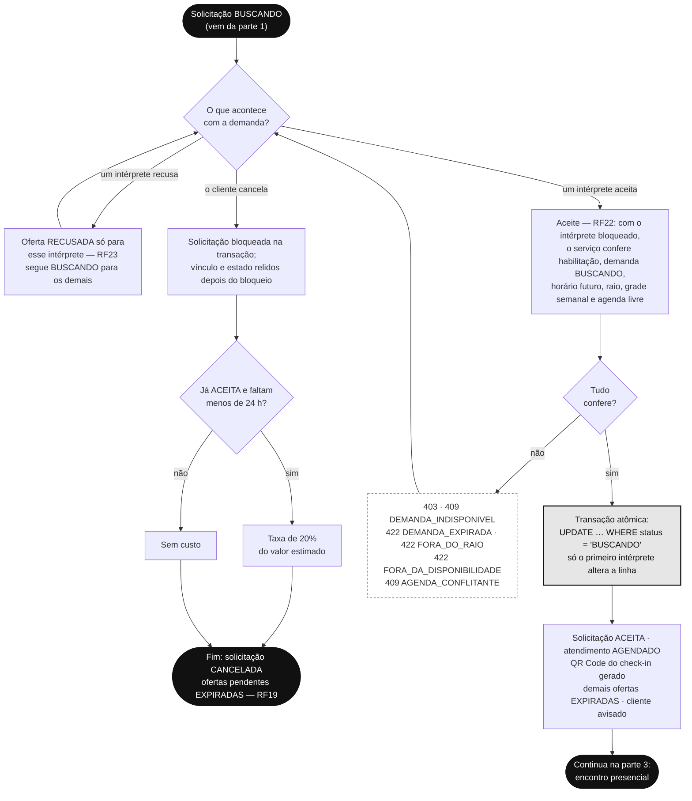

</details>

<a id="17-fluxograma-3-encontro-e-checkin"></a>

### Fluxograma do atendimento — parte 3: encontro presencial e check-in

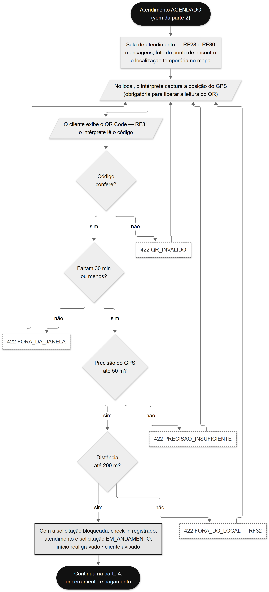

Fonte: Autoria própria apoiado por IA generativa (gerado a partir do código-fonte).

A tela do intérprete só libera a leitura do QR depois da captura da posição do aparelho; no servidor, as quatro validações do check-in aparecem na mesma ordem de `realizarCheckin` (`atendimento.service.ts`): código do QR, janela de horário, precisão do GPS e distância ao local. As caixas tracejadas são as respostas de erro devolvidas pela API em cada desvio; todos os números vêm de `backend/src/config/regras.ts`.

<details>
<summary>Fonte Mermaid (<code>docs/diagramas/fontes/17-fluxograma-3-encontro-e-checkin.mmd</code>)</summary>

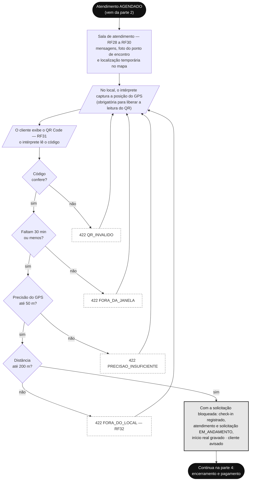

</details>

<a id="17-fluxograma-4-pagamento-e-avaliacao"></a>

### Fluxograma do atendimento — parte 4: encerramento, pagamento e avaliação

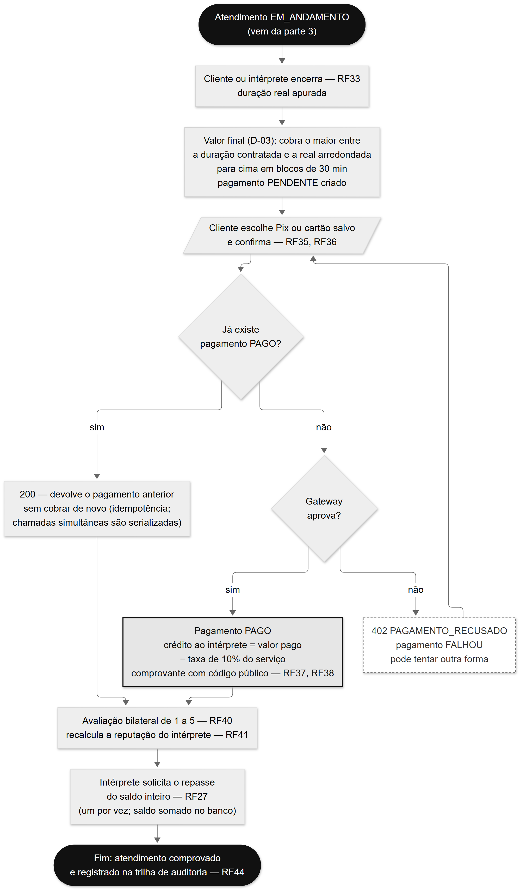

Fonte: Autoria própria apoiado por IA generativa (gerado a partir do código-fonte).

Fechamento financeiro conforme `encerrarAtendimento` e `processarPagamento`, inclusive a resposta idempotente e a recusa do gateway, até a avaliação e o repasse. As caixas tracejadas são as respostas de erro devolvidas pela API em cada desvio; todos os números vêm de `backend/src/config/regras.ts`.

<details>
<summary>Fonte Mermaid (<code>docs/diagramas/fontes/17-fluxograma-4-pagamento-e-avaliacao.mmd</code>)</summary>

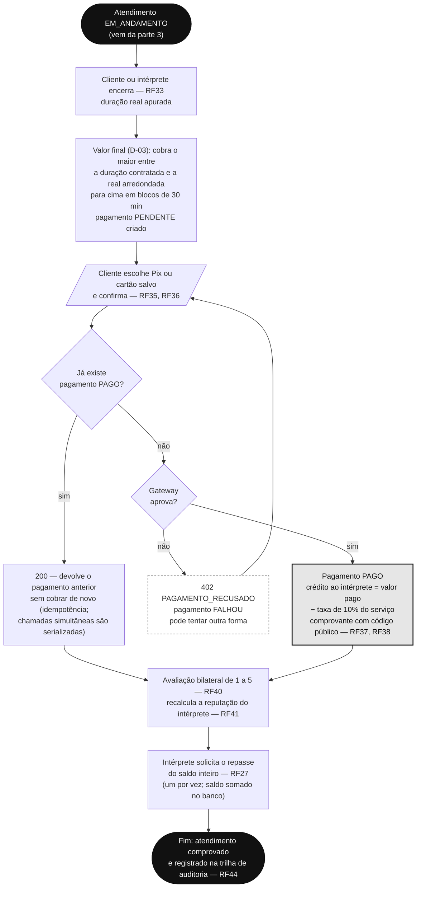

</details>

## Item #22 — Diagrama entidade-relacionamento

<a id="22-der-1-identidade-e-perfis"></a>

### DER — Identidade e perfis (DC1, DC11)

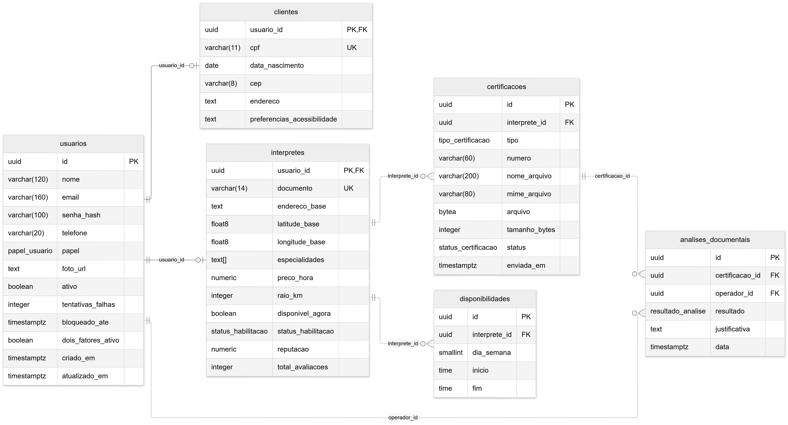

Fonte: Autoria própria apoiado por IA generativa (gerado a partir do código-fonte).

Tabelas do domínio, com todos os atributos: `usuarios`, `clientes`, `interpretes`, `certificacoes`, `analises_documentais`, `disponibilidades`. Regras de integridade além de PK/FK: `UNIQUE usuarios(lower(email))`; `CHECK interpretes: raio_km BETWEEN 1 AND 15`; `CHECK disponibilidades: dia_semana BETWEEN 0 AND 6`.

<details>
<summary>Fonte Mermaid (<code>docs/diagramas/fontes/22-der-1-identidade-e-perfis.mmd</code>)</summary>

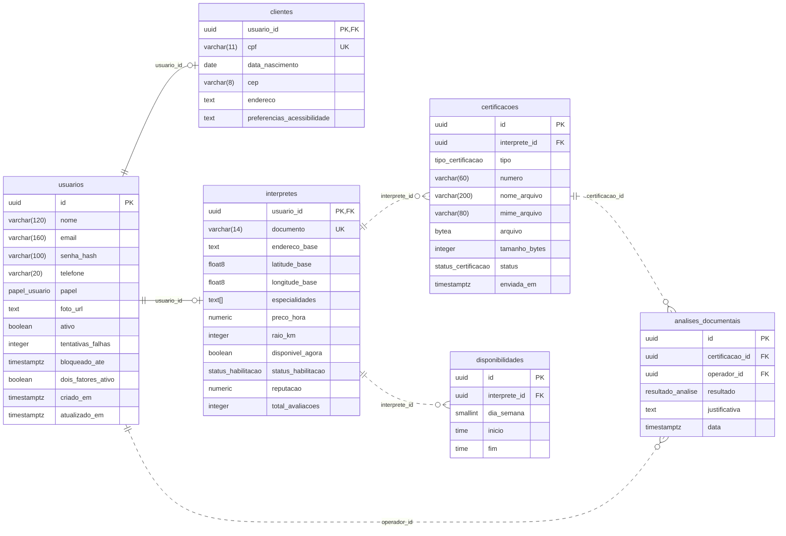

</details>

<a id="22-der-2-solicitacao-cotacao-distribuicao-e-aceite"></a>

### DER — Solicitação, cotação, distribuição e aceite (DC3, DC4)

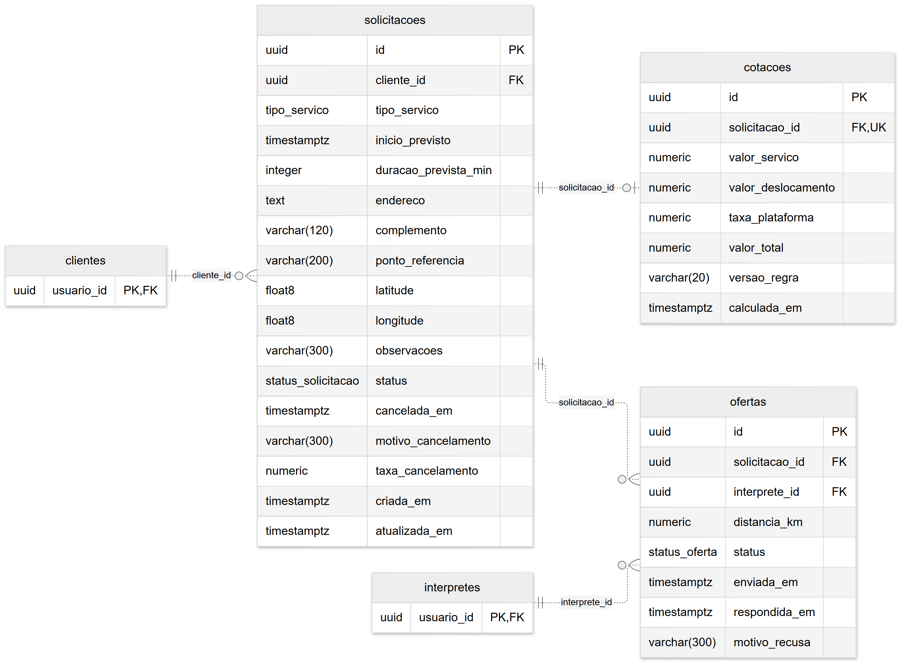

Fonte: Autoria própria apoiado por IA generativa (gerado a partir do código-fonte).

Tabelas do domínio, com todos os atributos: `solicitacoes`, `cotacoes`, `ofertas`. Tabelas de outros domínios referenciadas por elas (só com a PK, para contexto): `clientes`, `interpretes`. Regras de integridade além de PK/FK: `CHECK solicitacoes: duracao_prevista_min >= 60`; `UNIQUE ofertas(solicitacao_id, interprete_id)`.

<details>
<summary>Fonte Mermaid (<code>docs/diagramas/fontes/22-der-2-solicitacao-cotacao-distribuicao-e-aceite.mmd</code>)</summary>

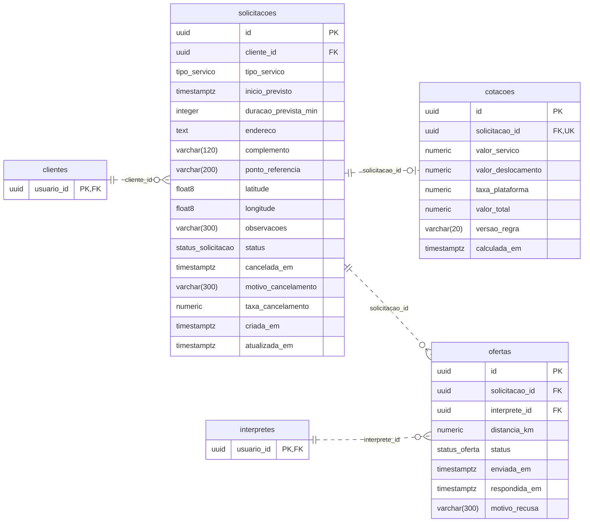

</details>

<a id="22-der-3-atendimento-presencial"></a>

### DER — Atendimento presencial (DC4, DC5, DC6)

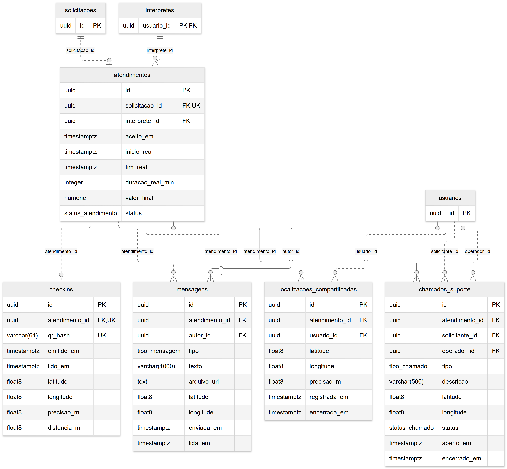

Fonte: Autoria própria apoiado por IA generativa (gerado a partir do código-fonte).

Tabelas do domínio, com todos os atributos: `atendimentos`, `checkins`, `mensagens`, `localizacoes_compartilhadas`, `chamados_suporte`. Tabelas de outros domínios referenciadas por elas (só com a PK, para contexto): `solicitacoes`, `interpretes`, `usuarios`. 

<details>
<summary>Fonte Mermaid (<code>docs/diagramas/fontes/22-der-3-atendimento-presencial.mmd</code>)</summary>

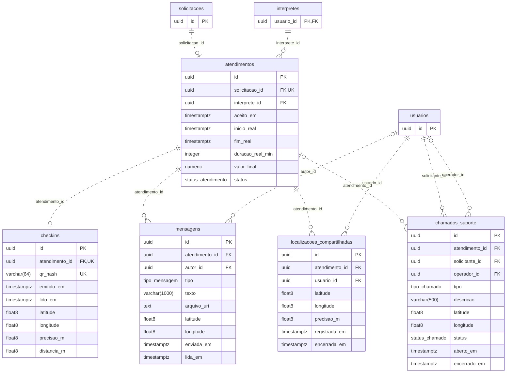

</details>

<a id="22-der-4-financeiro"></a>

### DER — Financeiro (DC7, DC8)

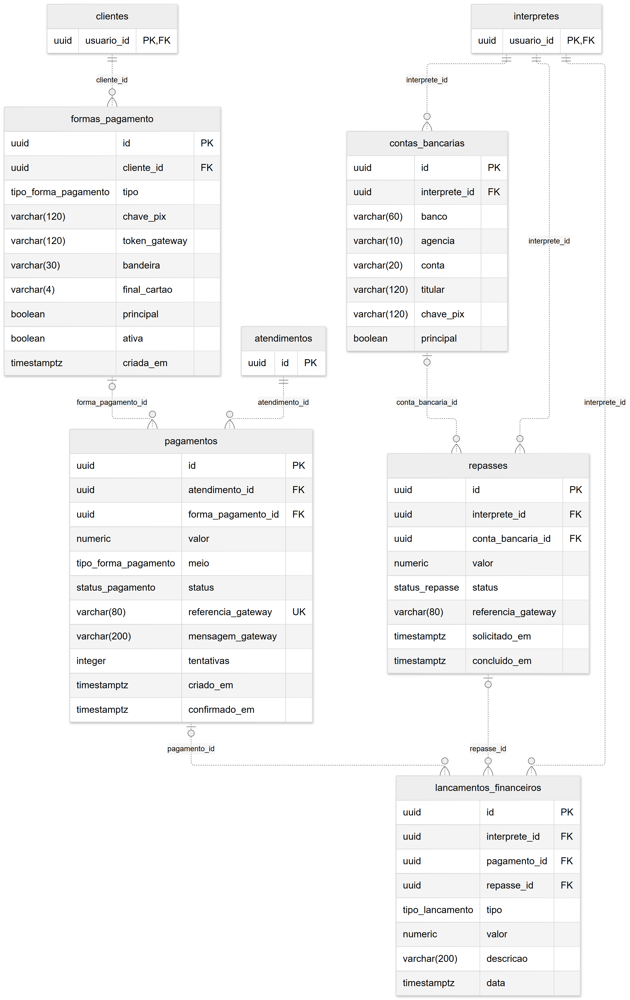

Fonte: Autoria própria apoiado por IA generativa (gerado a partir do código-fonte).

Tabelas do domínio, com todos os atributos: `formas_pagamento`, `pagamentos`, `contas_bancarias`, `repasses`, `lancamentos_financeiros`. Tabelas de outros domínios referenciadas por elas (só com a PK, para contexto): `clientes`, `atendimentos`, `interpretes`. Regras de integridade além de PK/FK: `UNIQUE pagamentos(atendimento_id) WHERE status = 'PAGO'`; `CHECK lancamentos_financeiros: (pagamento_id IS NOT NULL AND repasse_id IS NULL) OR (pagamento_id IS NULL AND repasse_id IS NOT NULL)`.

<details>
<summary>Fonte Mermaid (<code>docs/diagramas/fontes/22-der-4-financeiro.mmd</code>)</summary>

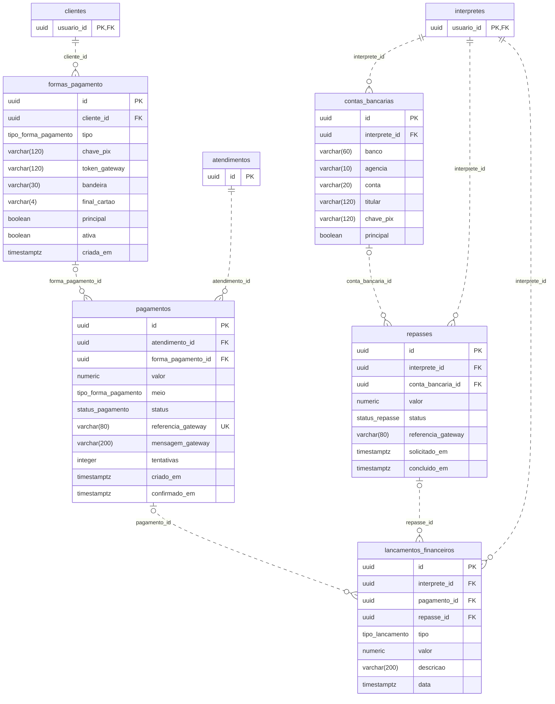

</details>

<a id="22-der-5-pos-atendimento"></a>

### DER — Pós-atendimento (DC9)

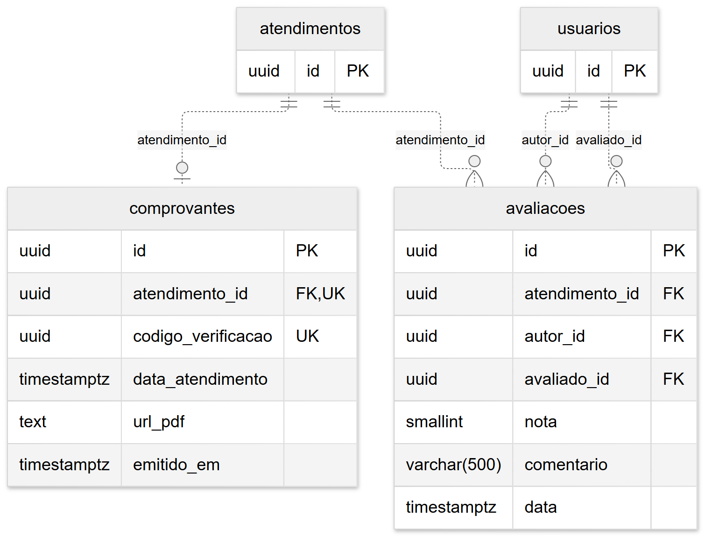

Fonte: Autoria própria apoiado por IA generativa (gerado a partir do código-fonte).

Tabelas do domínio, com todos os atributos: `avaliacoes`, `comprovantes`. Tabelas de outros domínios referenciadas por elas (só com a PK, para contexto): `atendimentos`, `usuarios`. Regras de integridade além de PK/FK: `CHECK avaliacoes: nota BETWEEN 1 AND 5`; `CHECK avaliacoes: autor_id <> avaliado_id`; `UNIQUE avaliacoes(atendimento_id, autor_id)`.

<details>
<summary>Fonte Mermaid (<code>docs/diagramas/fontes/22-der-5-pos-atendimento.mmd</code>)</summary>

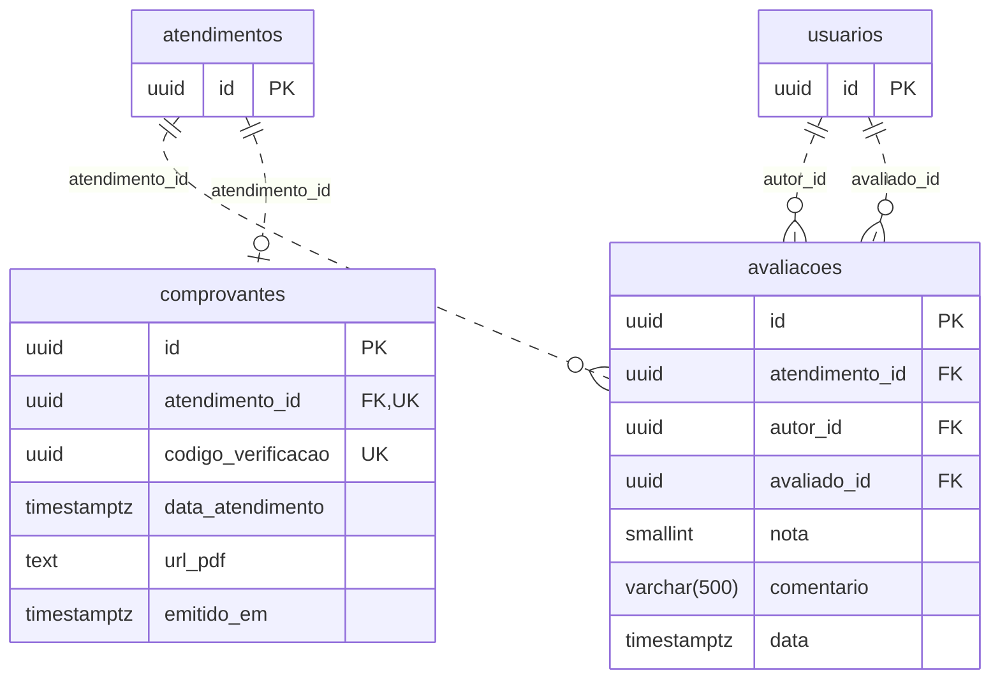

</details>

<a id="22-der-6-privacidade-notificacoes-sessoes-e-auditoria"></a>

### DER — Privacidade, notificações, sessões e auditoria (DC10, DC11)

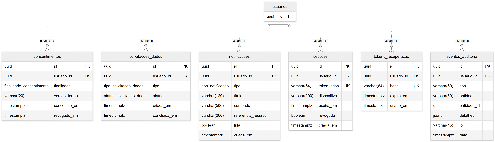

Fonte: Autoria própria apoiado por IA generativa (gerado a partir do código-fonte).

Tabelas do domínio, com todos os atributos: `consentimentos`, `solicitacoes_dados`, `notificacoes`, `sessoes`, `tokens_recuperacao`, `eventos_auditoria`. Tabelas de outros domínios referenciadas por elas (só com a PK, para contexto): `usuarios`. 

<details>
<summary>Fonte Mermaid (<code>docs/diagramas/fontes/22-der-6-privacidade-notificacoes-sessoes-e-auditoria.mmd</code>)</summary>

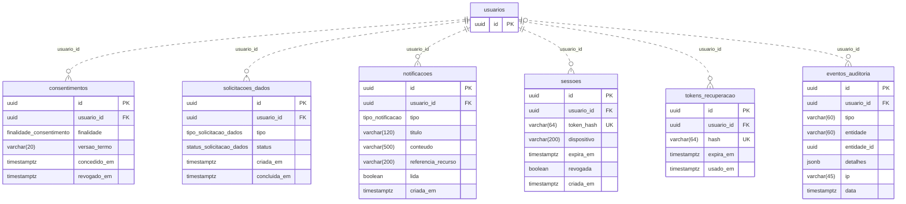

</details>

<a id="22-der-visao-geral"></a>

### DER — visão geral (27 tabelas e seus relacionamentos)

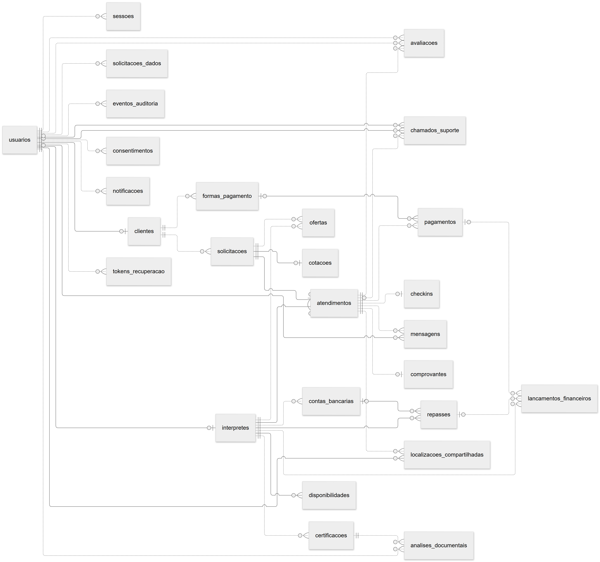

Fonte: Autoria própria apoiado por IA generativa (gerado a partir do código-fonte).

Gerado de `backend/src/models/schema.ts`: 27 tabelas, 230 colunas, 39 chaves estrangeiras e 20 tipos enumerados. Esta visão mostra só as entidades e os relacionamentos; os atributos e o nome de cada chave estrangeira estão nas visões por domínio e no dicionário de dados. Notação pé-de-galinha: linha contínua = relacionamento identificador (a FK compõe a PK da filha); linha tracejada = não identificador; "o" = opcional.

<details>
<summary>Fonte Mermaid (<code>docs/diagramas/fontes/22-der-visao-geral.mmd</code>)</summary>

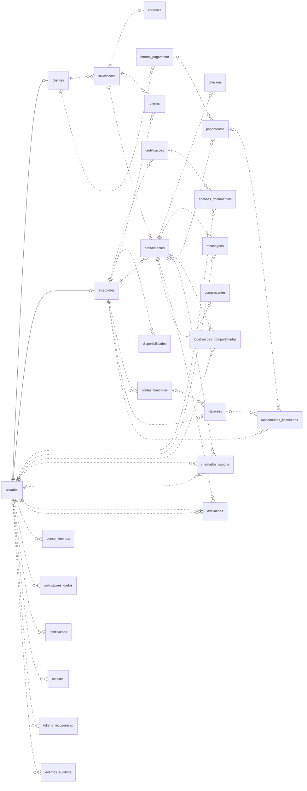

</details>

## Item #23 — Diagrama de estado de máquina

<a id="23-estados-1-solicitacao"></a>

### Máquina de estados — solicitação (RF16–RF19, RF22, RF31, RF33)

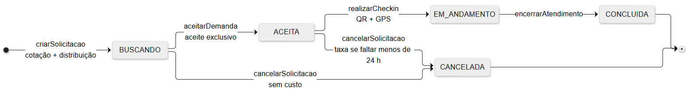

Fonte: Autoria própria apoiado por IA generativa (gerado a partir do código-fonte).

Estados do enum `status_solicitacao` do banco (`backend/src/models/schema.ts`) e as transições executadas pelos serviços, rotuladas com a função que as realiza. Todos os valores do enum aparecem no diagrama.

<details>
<summary>Fonte Mermaid (<code>docs/diagramas/fontes/23-estados-1-solicitacao.mmd</code>)</summary>

```mermaid
stateDiagram-v2
  direction LR
  [*] --> BUSCANDO : criarSolicitacao<br/>cotação + distribuição
  BUSCANDO --> ACEITA : aceitarDemanda<br/>aceite exclusivo
  BUSCANDO --> CANCELADA : cancelarSolicitacao<br/>sem custo
  ACEITA --> CANCELADA : cancelarSolicitacao<br/>taxa se faltar menos de 24 h
  ACEITA --> EM_ANDAMENTO : realizarCheckin<br/>QR + GPS
  EM_ANDAMENTO --> CONCLUIDA : encerrarAtendimento
  CONCLUIDA --> [*]
  CANCELADA --> [*]
```

</details>

<a id="23-estados-2-atendimento"></a>

### Máquina de estados — atendimento (RF22, RF31–RF33)

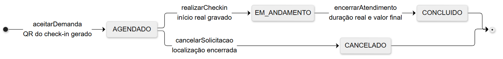

Fonte: Autoria própria apoiado por IA generativa (gerado a partir do código-fonte).

Estados do enum `status_atendimento` do banco (`backend/src/models/schema.ts`) e as transições executadas pelos serviços, rotuladas com a função que as realiza. Todos os valores do enum aparecem no diagrama.

<details>
<summary>Fonte Mermaid (<code>docs/diagramas/fontes/23-estados-2-atendimento.mmd</code>)</summary>

```mermaid
stateDiagram-v2
  direction LR
  [*] --> AGENDADO : aceitarDemanda<br/>QR do check-in gerado
  AGENDADO --> EM_ANDAMENTO : realizarCheckin<br/>início real gravado
  AGENDADO --> CANCELADO : cancelarSolicitacao<br/>localização encerrada
  EM_ANDAMENTO --> CONCLUIDO : encerrarAtendimento<br/>duração real e valor final
  CONCLUIDO --> [*]
  CANCELADO --> [*]
```

</details>

<a id="23-estados-3-pagamento"></a>

### Máquina de estados — pagamento (RF36, RF37)

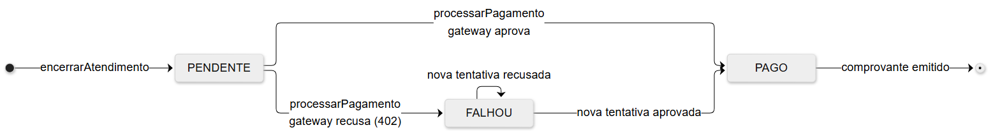

Fonte: Autoria própria apoiado por IA generativa (gerado a partir do código-fonte).

Estados do enum `status_pagamento` do banco (`backend/src/models/schema.ts`) e as transições executadas pelos serviços, rotuladas com a função que as realiza. Valor do enum sem transição no MVP: `ESTORNADO`.

<details>
<summary>Fonte Mermaid (<code>docs/diagramas/fontes/23-estados-3-pagamento.mmd</code>)</summary>

```mermaid
stateDiagram-v2
  direction LR
  [*] --> PENDENTE : encerrarAtendimento
  PENDENTE --> PAGO : processarPagamento<br/>gateway aprova
  PENDENTE --> FALHOU : processarPagamento<br/>gateway recusa (402)
  FALHOU --> PAGO : nova tentativa aprovada
  FALHOU --> FALHOU : nova tentativa recusada
  PAGO --> [*] : comprovante emitido
```

</details>

<a id="23-estados-4-habilitacao"></a>

### Máquina de estados — habilitação do intérprete (RF04–RF06, RNF36)

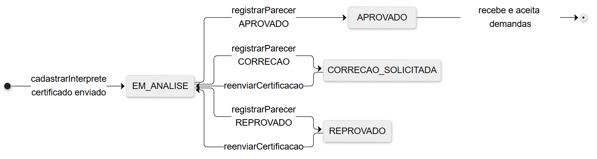

Fonte: Autoria própria apoiado por IA generativa (gerado a partir do código-fonte).

Estados do enum `status_habilitacao` do banco (`backend/src/models/schema.ts`) e as transições executadas pelos serviços, rotuladas com a função que as realiza. Valor do enum sem transição no MVP: `PENDENTE`.

<details>
<summary>Fonte Mermaid (<code>docs/diagramas/fontes/23-estados-4-habilitacao.mmd</code>)</summary>

```mermaid
stateDiagram-v2
  direction LR
  [*] --> EM_ANALISE : cadastrarInterprete<br/>certificado enviado
  EM_ANALISE --> APROVADO : registrarParecer<br/>APROVADO
  EM_ANALISE --> CORRECAO_SOLICITADA : registrarParecer<br/>CORRECAO
  EM_ANALISE --> REPROVADO : registrarParecer<br/>REPROVADO
  CORRECAO_SOLICITADA --> EM_ANALISE : reenviarCertificacao
  REPROVADO --> EM_ANALISE : reenviarCertificacao
  APROVADO --> [*] : recebe e aceita demandas
```

</details>

## Item #24 — Diagrama de operação

<a id="24-operacao-a-aceite-exclusivo"></a>

### Diagrama de operação — aceite exclusivo da demanda (RF22)

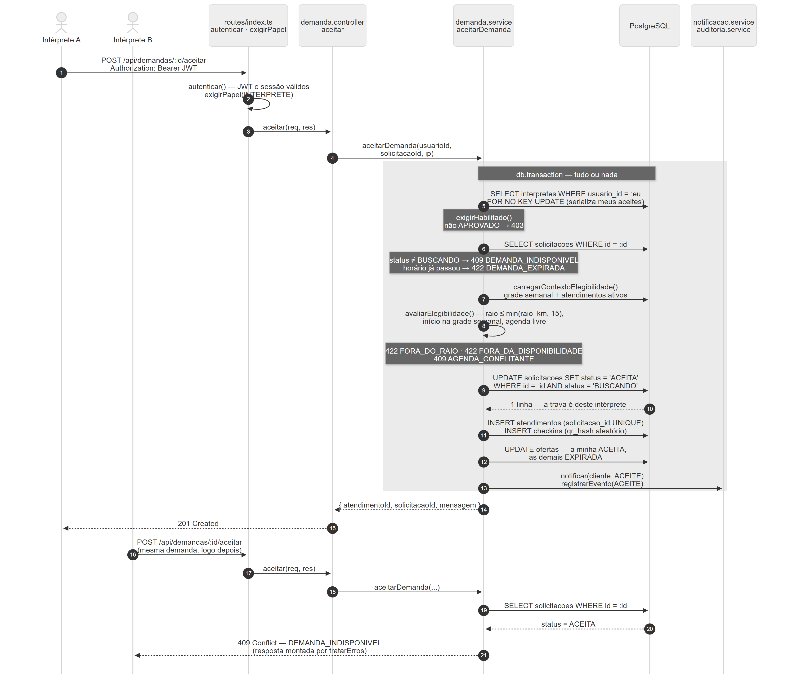

Fonte: Autoria própria apoiado por IA generativa (gerado a partir do código-fonte).

Sequência das chamadas internas quando dois intérpretes tentam aceitar a mesma demanda. Toda a verificação acontece numa transação que começa bloqueando o registro do intérprete (dois aceites dele não ocupam o mesmo horário) e aplica a mesma regra de elegibilidade da lista (D-20). A exclusividade entre intérpretes é garantida pelo `UPDATE … WHERE status = 'BUSCANDO'` e pelo índice único de `atendimentos.solicitacao_id`; quem chega depois recebe 409.

<details>
<summary>Fonte Mermaid (<code>docs/diagramas/fontes/24-operacao-a-aceite-exclusivo.mmd</code>)</summary>

```mermaid
sequenceDiagram
  autonumber
  actor IA as Intérprete A
  actor IB as Intérprete B
  participant RT as routes/index.ts<br/>autenticar · exigirPapel
  participant CT as demanda.controller<br/>aceitar
  participant SV as demanda.service<br/>aceitarDemanda
  participant DB as PostgreSQL
  participant AP as notificacao.service<br/>auditoria.service
  IA->>RT: POST /api/demandas/:id/aceitar<br/>Authorization: Bearer JWT
  RT->>RT: autenticar() — JWT e sessão válidos<br/>exigirPapel(INTERPRETE)
  RT->>CT: aceitar(req, res)
  CT->>SV: aceitarDemanda(usuarioId,<br/>solicitacaoId, ip)
  rect rgb(235, 235, 235)
  Note over SV,DB: db.transaction — tudo ou nada
  SV->>DB: SELECT interpretes WHERE usuario_id = :eu<br/>FOR NO KEY UPDATE (serializa meus aceites)
  Note over SV: exigirHabilitado()<br/>não APROVADO → 403
  SV->>DB: SELECT solicitacoes WHERE id = :id
  Note over SV: status ≠ BUSCANDO → 409 DEMANDA_INDISPONIVEL<br/>horário já passou → 422 DEMANDA_EXPIRADA
  SV->>DB: carregarContextoElegibilidade()<br/>grade semanal + atendimentos ativos
  SV->>SV: avaliarElegibilidade() — raio ≤ min(raio_km, 15),<br/>início na grade semanal, agenda livre
  Note over SV: 422 FORA_DO_RAIO · 422 FORA_DA_DISPONIBILIDADE<br/>409 AGENDA_CONFLITANTE
  SV->>DB: UPDATE solicitacoes SET status = 'ACEITA'<br/>WHERE id = :id AND status = 'BUSCANDO'
  DB-->>SV: 1 linha — a trava é deste intérprete
  SV->>DB: INSERT atendimentos (solicitacao_id UNIQUE)<br/>INSERT checkins (qr_hash aleatório)
  SV->>DB: UPDATE ofertas — a minha ACEITA,<br/>as demais EXPIRADA
  SV->>AP: notificar(cliente, ACEITE)<br/>registrarEvento(ACEITE)
  end
  SV-->>CT: { atendimentoId, solicitacaoId, mensagem }
  CT-->>IA: 201 Created
  IB->>RT: POST /api/demandas/:id/aceitar<br/>(mesma demanda, logo depois)
  RT->>CT: aceitar(req, res)
  CT->>SV: aceitarDemanda(...)
  SV->>DB: SELECT solicitacoes WHERE id = :id
  DB-->>SV: status = ACEITA
  SV-->>IB: 409 Conflict — DEMANDA_INDISPONIVEL<br/>(resposta montada por tratarErros)
```

</details>

<a id="24-operacao-b-checkin"></a>

### Diagrama de operação — check-in por QR Code e geolocalização (RF31, RF32)

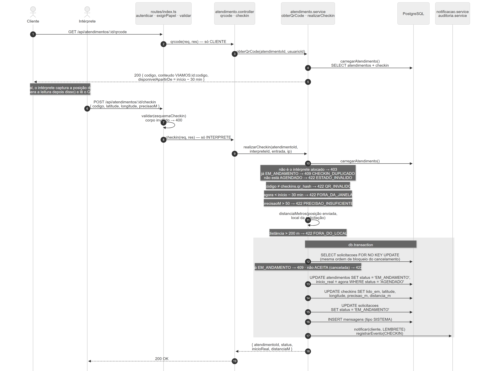

Fonte: Autoria própria apoiado por IA generativa (gerado a partir do código-fonte).

O cliente obtém o código do QR; o intérprete o envia com a posição do GPS. O serviço valida, nesta ordem: participante e estado, código, janela de horário, precisão do GPS e distância ao local. Na transação, a solicitação é bloqueada na mesma ordem usada pelo cancelamento (sem disputa invertida de bloqueios) e o estado é conferido de novo antes de iniciar o atendimento.

<details>
<summary>Fonte Mermaid (<code>docs/diagramas/fontes/24-operacao-b-checkin.mmd</code>)</summary>

```mermaid
sequenceDiagram
  autonumber
  actor CL as Cliente
  actor IN as Intérprete
  participant RT as routes/index.ts<br/>autenticar · exigirPapel · validar
  participant CT as atendimento.controller<br/>qrcode · checkin
  participant SV as atendimento.service<br/>obterQrCode · realizarCheckin
  participant DB as PostgreSQL
  participant AP as notificacao.service<br/>auditoria.service
  CL->>RT: GET /api/atendimentos/:id/qrcode
  RT->>CT: qrcode(req, res) — só CLIENTE
  CT->>SV: obterQrCode(atendimentoId, usuarioId)
  SV->>DB: carregarAtendimento()<br/>SELECT atendimentos + checkin
  SV-->>CL: 200 { codigo, conteudo VIAMOS:id:codigo,<br/>disponivelApartirDe = início − 30 min }
  Note over CL,IN: no local, o intérprete captura a posição do GPS<br/>(a tela só libera a leitura depois disso) e lê o QR do cliente
  IN->>RT: POST /api/atendimentos/:id/checkin<br/>{ codigo, latitude, longitude, precisaoM }
  RT->>RT: validar(esquemaCheckin)<br/>corpo inválido → 400
  RT->>CT: checkin(req, res) — só INTERPRETE
  CT->>SV: realizarCheckin(atendimentoId,<br/>interpreteId, entrada, ip)
  SV->>DB: carregarAtendimento()
  Note over SV: não é o intérprete alocado → 403<br/>já EM_ANDAMENTO → 409 CHECKIN_DUPLICADO<br/>não está AGENDADO → 422 ESTADO_INVALIDO
  Note over SV: código ≠ checkins.qr_hash → 422 QR_INVALIDO
  Note over SV: agora < início − 30 min → 422 FORA_DA_JANELA
  Note over SV: precisaoM > 50 → 422 PRECISAO_INSUFICIENTE
  SV->>SV: distanciaMetros(posição enviada,<br/>local da solicitação)
  Note over SV: distância > 200 m → 422 FORA_DO_LOCAL
  rect rgb(235, 235, 235)
  Note over SV,DB: db.transaction
  SV->>DB: SELECT solicitacoes FOR NO KEY UPDATE<br/>(mesma ordem de bloqueio do cancelamento)
  Note over SV: já EM_ANDAMENTO → 409 · não ACEITA (cancelada) → 422
  SV->>DB: UPDATE atendimentos SET status = 'EM_ANDAMENTO',<br/>inicio_real = agora WHERE status = 'AGENDADO'
  SV->>DB: UPDATE checkins SET lido_em, latitude,<br/>longitude, precisao_m, distancia_m
  SV->>DB: UPDATE solicitacoes<br/>SET status = 'EM_ANDAMENTO'
  SV->>DB: INSERT mensagens (tipo SISTEMA)
  SV->>AP: notificar(cliente, LEMBRETE)<br/>registrarEvento(CHECKIN)
  end
  SV-->>CT: { atendimentoId, status,<br/>inicioReal, distanciaM }
  CT-->>IN: 200 OK
```

</details>

<a id="24-operacao-c-encerramento"></a>

### Diagrama de operação — encerramento do atendimento (RF33)

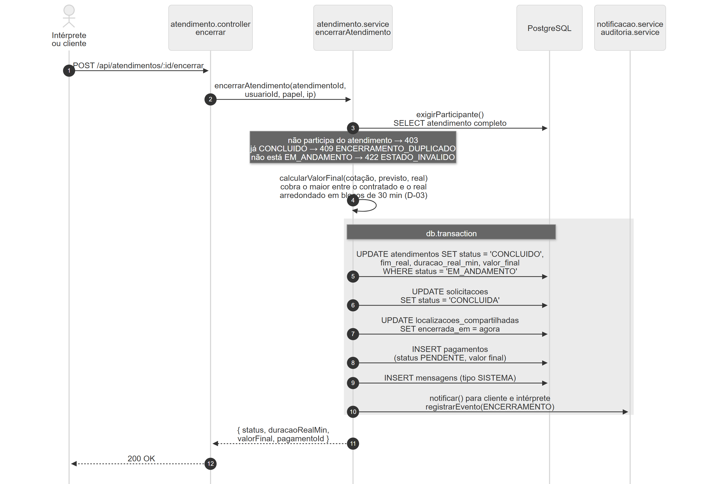

Fonte: Autoria própria apoiado por IA generativa (gerado a partir do código-fonte).

Cliente ou intérprete encerra o atendimento em andamento. O serviço apura a duração real, calcula o valor final pela regra D-03 e, em uma única transação, conclui o atendimento e a solicitação, encerra o compartilhamento de localização e cria o pagamento pendente. O `WHERE status = 'EM_ANDAMENTO'` impede o encerramento em duplicidade.

<details>
<summary>Fonte Mermaid (<code>docs/diagramas/fontes/24-operacao-c-encerramento.mmd</code>)</summary>

```mermaid
sequenceDiagram
  autonumber
  actor US as Intérprete<br/>ou cliente
  participant CT as atendimento.controller<br/>encerrar
  participant AT as atendimento.service<br/>encerrarAtendimento
  participant DB as PostgreSQL
  participant AP as notificacao.service<br/>auditoria.service
  US->>CT: POST /api/atendimentos/:id/encerrar
  CT->>AT: encerrarAtendimento(atendimentoId,<br/>usuarioId, papel, ip)
  AT->>DB: exigirParticipante()<br/>SELECT atendimento completo
  Note over AT: não participa do atendimento → 403<br/>já CONCLUIDO → 409 ENCERRAMENTO_DUPLICADO<br/>não está EM_ANDAMENTO → 422 ESTADO_INVALIDO
  AT->>AT: calcularValorFinal(cotação, previsto, real)<br/>cobra o maior entre o contratado e o real<br/>arredondado em blocos de 30 min (D-03)
  rect rgb(235, 235, 235)
  Note over AT,DB: db.transaction
  AT->>DB: UPDATE atendimentos SET status = 'CONCLUIDO',<br/>fim_real, duracao_real_min, valor_final<br/>WHERE status = 'EM_ANDAMENTO'
  AT->>DB: UPDATE solicitacoes<br/>SET status = 'CONCLUIDA'
  AT->>DB: UPDATE localizacoes_compartilhadas<br/>SET encerrada_em = agora
  AT->>DB: INSERT pagamentos<br/>(status PENDENTE, valor final)
  AT->>DB: INSERT mensagens (tipo SISTEMA)
  AT->>AP: notificar() para cliente e intérprete<br/>registrarEvento(ENCERRAMENTO)
  end
  AT-->>CT: { status, duracaoRealMin,<br/>valorFinal, pagamentoId }
  CT-->>US: 200 OK
```

</details>

<a id="24-operacao-d-pagamento-comprovante"></a>

### Diagrama de operação — pagamento idempotente e comprovante (RF36, RF37)

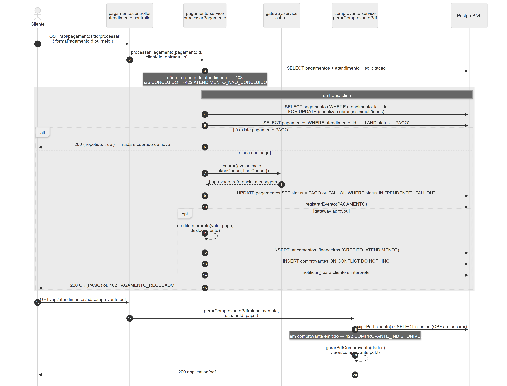

Fonte: Autoria própria apoiado por IA generativa (gerado a partir do código-fonte).

A cobrança começa bloqueando os pagamentos do atendimento: duas chamadas simultâneas são serializadas e a segunda encontra o pagamento já PAGO, devolvendo o mesmo resultado sem chamar o gateway de novo. Aprovado pelo gateway, a mesma transação credita o intérprete e emite o comprovante, que depois é entregue em PDF; recusado, a API responde 402 e o cliente pode tentar outra forma.

<details>
<summary>Fonte Mermaid (<code>docs/diagramas/fontes/24-operacao-d-pagamento-comprovante.mmd</code>)</summary>

```mermaid
sequenceDiagram
  autonumber
  actor CL as Cliente
  participant CT as pagamento.controller<br/>atendimento.controller
  participant PG as pagamento.service<br/>processarPagamento
  participant GW as gateway.service<br/>cobrar
  participant CP as comprovante.service<br/>gerarComprovantePdf
  participant DB as PostgreSQL
  CL->>CT: POST /api/pagamentos/:id/processar<br/>{ formaPagamentoId ou meio }
  CT->>PG: processarPagamento(pagamentoId,<br/>clienteId, entrada, ip)
  PG->>DB: SELECT pagamentos + atendimento + solicitacao
  Note over PG: não é o cliente do atendimento → 403<br/>não CONCLUIDO → 422 ATENDIMENTO_NAO_CONCLUIDO
  rect rgb(235, 235, 235)
  Note over PG,DB: db.transaction
  PG->>DB: SELECT pagamentos WHERE atendimento_id = :id<br/>FOR UPDATE (serializa cobranças simultâneas)
  PG->>DB: SELECT pagamentos WHERE atendimento_id = :id AND status = 'PAGO'
  alt já existe pagamento PAGO
  PG-->>CL: 200 { repetido: true } — nada é cobrado de novo
  else ainda não pago
  PG->>GW: cobrar({ valor, meio,<br/>tokenCartao, finalCartao })
  GW-->>PG: { aprovado, referencia, mensagem }
  PG->>DB: UPDATE pagamentos SET status = PAGO ou FALHOU WHERE status IN ('PENDENTE', 'FALHOU')
  PG->>DB: registrarEvento(PAGAMENTO)
  opt gateway aprovou
  PG->>PG: creditoInterprete(valor pago,<br/>deslocamento)
  PG->>DB: INSERT lancamentos_financeiros (CREDITO_ATENDIMENTO)
  PG->>DB: INSERT comprovantes ON CONFLICT DO NOTHING
  PG->>DB: notificar() para cliente e intérprete
  end
  PG-->>CL: 200 OK (PAGO) ou 402 PAGAMENTO_RECUSADO
  end
  end
  CL->>CT: GET /api/atendimentos/:id/comprovante.pdf
  CT->>CP: gerarComprovantePdf(atendimentoId,<br/>usuarioId, papel)
  CP->>DB: exigirParticipante() · SELECT clientes (CPF a mascarar)
  Note over CP: sem comprovante emitido → 422 COMPROVANTE_INDISPONIVEL
  CP->>CP: gerarPdfComprovante(dados)<br/>views/comprovante.pdf.ts
  CP-->>CL: 200 application/pdf
```

</details>

## Item #26 — Diagrama de processos (telas)

<a id="26-telas-backoffice"></a>

### Processos de telas — backoffice

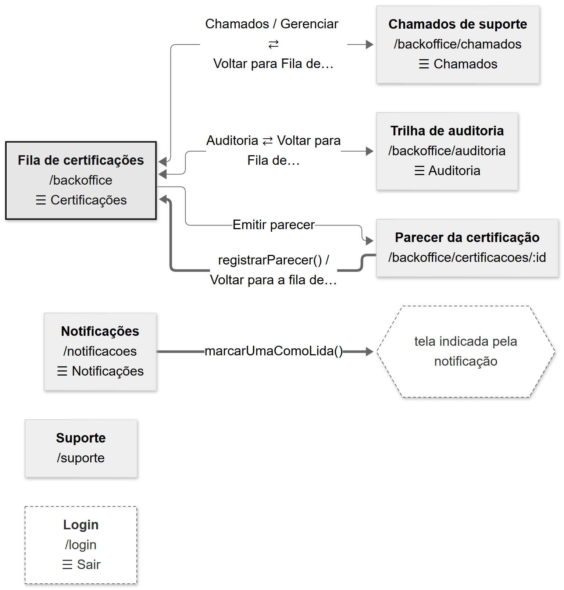

Fonte: Autoria própria apoiado por IA generativa (gerado a partir do código-fonte).

Transições entre telas extraídas do código de cada tela (`<Link>`, `<Navigate>` e `navigate()`): 7 transições a partir de 6 telas, das quais 2 pares de ida e volta. Seta simples: clique em um link ou botão, rotulada com o texto do elemento. Seta de duas pontas (⇄): ida e volta por cliques entre as mesmas telas. Seta grossa: navegação feita pelo código depois que a ação é concluída, rotulada com a função. Seta tracejada: redirecionamento automático. Caixas tracejadas são telas de outra área. A marca "☰" indica as telas abertas pelo menu principal, a barra de navegação presente em todas as telas da área (lida de `frontend/src/components/AppShell.tsx`). A lista completa, com arquivo e linha de cada transição, está em `docs/producao-tecnica/tabelas/transicoes-de-telas.md`.

<details>
<summary>Fonte Mermaid (<code>docs/diagramas/fontes/26-telas-backoffice.mmd</code>)</summary>

```mermaid
flowchart LR
  classDef hub fill:#e6e6e6,stroke:#111,stroke-width:2px,color:#111;
  classDef externo fill:#fff,stroke:#666,stroke-dasharray:4 3,color:#333;
  classDef destaque fill:#f2f2f2,stroke:#111,stroke-width:1.5px,color:#111;
  r_backoffice["<b>Fila de certificações</b><br/>/backoffice<br/>☰ Certificações"]
  r_backoffice_certificacoes_id["<b>Parecer da certificação</b><br/>/backoffice/certificacoes/:id"]
  r_backoffice_chamados["<b>Chamados de suporte</b><br/>/backoffice/chamados<br/>☰ Chamados"]
  r_backoffice_auditoria["<b>Trilha de auditoria</b><br/>/backoffice/auditoria<br/>☰ Auditoria"]
  r_notificacoes["<b>Notificações</b><br/>/notificacoes<br/>☰ Notificações"]
  r_suporte["<b>Suporte</b><br/>/suporte"]
  r_login["<b>Login</b><br/>/login<br/>☰ Sair"]:::externo
  nota_1{{"tela indicada pela<br/>notificação"}}:::externo
  r_backoffice <-->|"Chamados / Gerenciar ⇄<br/>Voltar para Fila de…"| r_backoffice_chamados
  r_backoffice <-->|"Auditoria ⇄ Voltar para<br/>Fila de…"| r_backoffice_auditoria
  r_backoffice -->|"Emitir parecer"| r_backoffice_certificacoes_id
  r_backoffice_certificacoes_id ==>|"registrarParecer() /<br/>Voltar para a fila de…"| r_backoffice
  r_notificacoes ==>|"marcarUmaComoLida()"| nota_1
  class r_backoffice hub;
```

</details>

<a id="26-telas-cliente"></a>

### Processos de telas — área do cliente

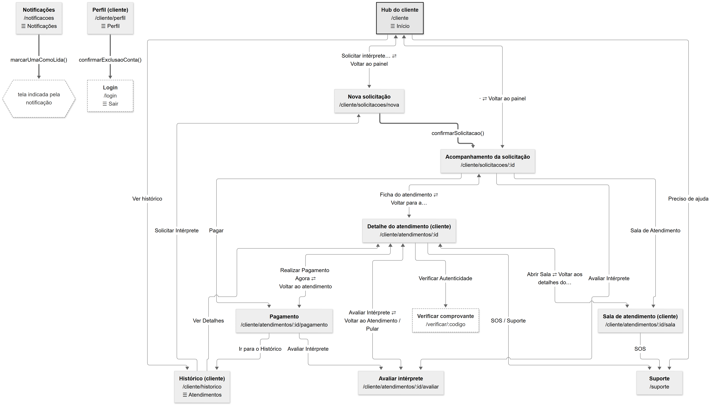

Fonte: Autoria própria apoiado por IA generativa (gerado a partir do código-fonte).

Transições entre telas extraídas do código de cada tela (`<Link>`, `<Navigate>` e `navigate()`): 27 transições a partir de 11 telas, das quais 6 pares de ida e volta. Seta simples: clique em um link ou botão, rotulada com o texto do elemento. Seta de duas pontas (⇄): ida e volta por cliques entre as mesmas telas. Seta grossa: navegação feita pelo código depois que a ação é concluída, rotulada com a função. Seta tracejada: redirecionamento automático. Caixas tracejadas são telas de outra área. A marca "☰" indica as telas abertas pelo menu principal, a barra de navegação presente em todas as telas da área (lida de `frontend/src/components/AppShell.tsx`). A lista completa, com arquivo e linha de cada transição, está em `docs/producao-tecnica/tabelas/transicoes-de-telas.md`.

<details>
<summary>Fonte Mermaid (<code>docs/diagramas/fontes/26-telas-cliente.mmd</code>)</summary>

```mermaid
flowchart TB
  classDef hub fill:#e6e6e6,stroke:#111,stroke-width:2px,color:#111;
  classDef externo fill:#fff,stroke:#666,stroke-dasharray:4 3,color:#333;
  classDef destaque fill:#f2f2f2,stroke:#111,stroke-width:1.5px,color:#111;
  r_cliente["<b>Hub do cliente</b><br/>/cliente<br/>☰ Início"]
  r_cliente_solicitacoes_nova["<b>Nova solicitação</b><br/>/cliente/solicitacoes/nova"]
  r_cliente_solicitacoes_id["<b>Acompanhamento da solicitação</b><br/>/cliente/solicitacoes/:id"]
  r_cliente_atendimentos_id["<b>Detalhe do atendimento (cliente)</b><br/>/cliente/atendimentos/:id"]
  r_cliente_atendimentos_id_sala["<b>Sala de atendimento (cliente)</b><br/>/cliente/atendimentos/:id/sala"]
  r_cliente_atendimentos_id_pagamento["<b>Pagamento</b><br/>/cliente/atendimentos/:id/pagamento"]
  r_cliente_atendimentos_id_avaliar["<b>Avaliar intérprete</b><br/>/cliente/atendimentos/:id/avaliar"]
  r_cliente_historico["<b>Histórico (cliente)</b><br/>/cliente/historico<br/>☰ Atendimentos"]
  r_cliente_perfil["<b>Perfil (cliente)</b><br/>/cliente/perfil<br/>☰ Perfil"]
  r_notificacoes["<b>Notificações</b><br/>/notificacoes<br/>☰ Notificações"]
  r_suporte["<b>Suporte</b><br/>/suporte"]
  r_verificar_codigo["<b>Verificar comprovante</b><br/>/verificar/:codigo"]:::externo
  r_login["<b>Login</b><br/>/login<br/>☰ Sair"]:::externo
  nota_1{{"tela indicada pela<br/>notificação"}}:::externo
  r_cliente <-->|"Solicitar intérprete… ⇄<br/>Voltar ao painel"| r_cliente_solicitacoes_nova
  r_cliente -->|"Ver histórico"| r_cliente_historico
  r_cliente -->|"Preciso de ajuda"| r_suporte
  r_cliente <-->|"· ⇄ Voltar ao painel"| r_cliente_solicitacoes_id
  r_cliente_solicitacoes_nova ==>|"confirmarSolicitacao()"| r_cliente_solicitacoes_id
  r_cliente_solicitacoes_id <-->|"Ficha do atendimento ⇄<br/>Voltar para a…"| r_cliente_atendimentos_id
  r_cliente_solicitacoes_id -->|"Sala de Atendimento"| r_cliente_atendimentos_id_sala
  r_cliente_solicitacoes_id -->|"Pagar"| r_cliente_atendimentos_id_pagamento
  r_cliente_solicitacoes_id -->|"Avaliar Intérprete"| r_cliente_atendimentos_id_avaliar
  r_cliente_atendimentos_id <-->|"Abrir Sala ⇄ Voltar aos<br/>detalhes do…"| r_cliente_atendimentos_id_sala
  r_cliente_atendimentos_id -->|"SOS / Suporte"| r_suporte
  r_cliente_atendimentos_id <-->|"Realizar Pagamento Agora ⇄<br/>Voltar ao atendimento"| r_cliente_atendimentos_id_pagamento
  r_cliente_atendimentos_id -->|"Verificar Autenticidade"| r_verificar_codigo
  r_cliente_atendimentos_id <-->|"Avaliar Intérprete ⇄<br/>Voltar ao Atendimento /<br/>Pular"| r_cliente_atendimentos_id_avaliar
  r_cliente_atendimentos_id_sala -->|"SOS"| r_suporte
  r_cliente_atendimentos_id_pagamento -->|"Avaliar Intérprete"| r_cliente_atendimentos_id_avaliar
  r_cliente_atendimentos_id_pagamento -->|"Ir para o Histórico"| r_cliente_historico
  r_cliente_historico -->|"Solicitar Intérprete"| r_cliente_solicitacoes_nova
  r_cliente_historico -->|"Ver Detalhes"| r_cliente_atendimentos_id
  r_cliente_perfil ==>|"confirmarExclusaoConta()"| r_login
  r_notificacoes ==>|"marcarUmaComoLida()"| nota_1
  class r_cliente hub;
```

</details>

<a id="26-telas-interprete"></a>

### Processos de telas — área do intérprete


Fonte: Autoria própria apoiado por IA generativa (gerado a partir do código-fonte).

Transições entre telas extraídas do código de cada tela (`<Link>`, `<Navigate>` e `navigate()`): 27 transições a partir de 12 telas, das quais 4 pares de ida e volta. Seta simples: clique em um link ou botão, rotulada com o texto do elemento. Seta de duas pontas (⇄): ida e volta por cliques entre as mesmas telas. Seta grossa: navegação feita pelo código depois que a ação é concluída, rotulada com a função. Seta tracejada: redirecionamento automático. Caixas tracejadas são telas de outra área. A marca "☰" indica as telas abertas pelo menu principal, a barra de navegação presente em todas as telas da área (lida de `frontend/src/components/AppShell.tsx`). A lista completa, com arquivo e linha de cada transição, está em `docs/producao-tecnica/tabelas/transicoes-de-telas.md`.

<details>
<summary>Fonte Mermaid (<code>docs/diagramas/fontes/26-telas-interprete.mmd</code>)</summary>

```mermaid
flowchart TB
  classDef hub fill:#e6e6e6,stroke:#111,stroke-width:2px,color:#111;
  classDef externo fill:#fff,stroke:#666,stroke-dasharray:4 3,color:#333;
  classDef destaque fill:#f2f2f2,stroke:#111,stroke-width:1.5px,color:#111;
  r_interprete["<b>Hub do intérprete</b><br/>/interprete<br/>☰ Início"]
  r_interprete_demandas["<b>Demandas próximas</b><br/>/interprete/demandas<br/>☰ Demandas"]
  r_interprete_demandas_id["<b>Detalhe da demanda</b><br/>/interprete/demandas/:id"]
  r_interprete_agenda["<b>Raio e disponibilidade</b><br/>/interprete/agenda"]
  r_interprete_atendimentos_id["<b>Detalhe do atendimento (intérprete)</b><br/>/interprete/atendimentos/:id"]
  r_interprete_atendimentos_id_sala["<b>Sala de atendimento (intérprete)</b><br/>/interprete/atendimentos/:id/sala"]
  r_interprete_atendimentos_id_avaliar["<b>Avaliar cliente</b><br/>/interprete/atendimentos/:id/avaliar"]
  r_interprete_ganhos["<b>Ganhos e repasse</b><br/>/interprete/ganhos<br/>☰ Ganhos"]
  r_interprete_historico["<b>Histórico (intérprete)</b><br/>/interprete/historico"]
  r_interprete_perfil["<b>Perfil e habilitação</b><br/>/interprete/perfil<br/>☰ Perfil"]
  r_notificacoes["<b>Notificações</b><br/>/notificacoes<br/>☰ Notificações"]
  r_suporte["<b>Suporte</b><br/>/suporte"]
  r_login["<b>Login</b><br/>/login<br/>☰ Sair"]:::externo
  nota_1{{"tela indicada pela<br/>notificação"}}:::externo
  r_interprete ==>|"aceitarDemanda() /<br/>Gerenciar Atendimento"| r_interprete_atendimentos_id
  r_interprete -->|"Ver documentação"| r_interprete_perfil
  r_interprete <-->|"Raio: … km / Configurar… ⇄<br/>Voltar ao painel"| r_interprete_agenda
  r_interprete -->|"Ver todas"| r_interprete_demandas
  r_interprete -->|"Detalhes"| r_interprete_demandas_id
  r_interprete -->|"Ver Extrato Completo"| r_interprete_ganhos
  r_interprete -->|"Abrir Sala de…"| r_interprete_atendimentos_id_sala
  r_interprete_demandas ==>|"aceitar() / Check-in /<br/>Detalhes"| r_interprete_atendimentos_id
  r_interprete_demandas -->|"Ajustar Raio ( km)"| r_interprete_agenda
  r_interprete_demandas -->|"Detalhes"| r_interprete_demandas_id
  r_interprete_demandas -->|"Sala"| r_interprete_atendimentos_id_sala
  r_interprete_demandas_id ==>|"aceitarDemanda() / Ir para<br/>o Atendimento…"| r_interprete_atendimentos_id
  r_interprete_demandas_id ==>|"confirmarRecusa() / Voltar<br/>às demandas"| r_interprete_demandas
  r_interprete_atendimentos_id -->|"Voltar ao painel do…"| r_interprete
  r_interprete_atendimentos_id <-->|"Sala de Atendimento ⇄<br/>Voltar aos detalhes do…"| r_interprete_atendimentos_id_sala
  r_interprete_atendimentos_id -->|"SOS / Suporte"| r_suporte
  r_interprete_atendimentos_id <-->|"Avaliar Cliente ⇄ Voltar<br/>ao Atendimento / Pular"| r_interprete_atendimentos_id_avaliar
  r_interprete_atendimentos_id <-->|"Ver em Ganhos e Repasses ⇄<br/>·"| r_interprete_ganhos
  r_interprete_atendimentos_id_sala -->|"SOS"| r_suporte
  r_interprete_ganhos -->|"Histórico de…"| r_interprete_historico
  r_interprete_historico -->|"Ver Detalhes"| r_interprete_atendimentos_id
  r_interprete_perfil ==>|"excluirConta()"| r_login
  r_notificacoes ==>|"marcarUmaComoLida()"| nota_1
  class r_interprete hub;
```

</details>

<a id="26-telas-publico"></a>

### Processos de telas — área pública (sem login)


Fonte: Autoria própria apoiado por IA generativa (gerado a partir do código-fonte).

Transições entre telas extraídas do código de cada tela (`<Link>`, `<Navigate>` e `navigate()`): 22 transições a partir de 8 telas, das quais 4 pares de ida e volta. Seta simples: clique em um link ou botão, rotulada com o texto do elemento. Seta de duas pontas (⇄): ida e volta por cliques entre as mesmas telas. Seta grossa: navegação feita pelo código depois que a ação é concluída, rotulada com a função. Seta tracejada: redirecionamento automático. Caixas tracejadas são telas de outra área. A lista completa, com arquivo e linha de cada transição, está em `docs/producao-tecnica/tabelas/transicoes-de-telas.md`.

<details>
<summary>Fonte Mermaid (<code>docs/diagramas/fontes/26-telas-publico.mmd</code>)</summary>

```mermaid
flowchart TB
  classDef hub fill:#e6e6e6,stroke:#111,stroke-width:2px,color:#111;
  classDef externo fill:#fff,stroke:#666,stroke-dasharray:4 3,color:#333;
  classDef destaque fill:#f2f2f2,stroke:#111,stroke-width:1.5px,color:#111;
  r_raiz["<b>Splash</b><br/>/"]
  r_login["<b>Login</b><br/>/login"]
  r_recuperar_senha["<b>Recuperar senha</b><br/>/recuperar-senha"]
  r_redefinir_senha_token["<b>Redefinir senha</b><br/>/redefinir-senha/:token"]
  r_cadastro["<b>Seleção de perfil</b><br/>/cadastro"]
  r_cadastro_cliente["<b>Cadastro do cliente</b><br/>/cadastro/cliente"]
  r_cadastro_interprete["<b>Cadastro do intérprete</b><br/>/cadastro/interprete"]
  r_verificar_codigo["<b>Verificar comprovante</b><br/>/verificar/:codigo"]
  r_cliente["<b>Hub do cliente</b><br/>/cliente"]:::externo
  r_interprete["<b>Hub do intérprete</b><br/>/interprete"]:::externo
  r_backoffice["<b>Fila de certificações</b><br/>/backoffice"]:::externo
  r_raiz -.->|"sessão ativa"| r_cliente
  r_raiz -.->|"sessão ativa"| r_interprete
  r_raiz -.->|"sessão ativa"| r_backoffice
  r_raiz -.-> r_login
  r_login ==>|"login válido"| r_cliente
  r_login ==>|"login válido"| r_interprete
  r_login ==>|"login válido"| r_backoffice
  r_login <-->|"Esqueci minha senha ⇄<br/>Voltar ao login"| r_recuperar_senha
  r_login <-->|"Cadastre-se ⇄ Entrar"| r_cadastro
  r_recuperar_senha <-->|"Abrir link de… ⇄ Solicitar<br/>um novo link…"| r_redefinir_senha_token
  r_redefinir_senha_token -->|"Ir para o login"| r_login
  r_cadastro -->|"Sou pessoa surda…"| r_cadastro_cliente
  r_cadastro <-->|"Sou intérprete de Libras…<br/>⇄ Voltar"| r_cadastro_interprete
  r_cadastro_cliente ==>|"enviar() / Ir para o<br/>início"| r_cliente
  r_cadastro_cliente -->|"Já tem uma conta? Voltar…"| r_login
  r_cadastro_interprete -->|"Ir para o painel do…"| r_interprete
  r_verificar_codigo ==>|"consultarOutro()"| r_verificar_codigo
  r_verificar_codigo -->|"Voltar ao acesso da…"| r_login
```

</details>

## Item #27 — Ferramenta CASE

<a id="27-ferramenta-case"></a>

### Ferramenta CASE — cadeia de geração dos modelos a partir do código


Fonte: Autoria própria apoiado por IA generativa (gerado a partir do código-fonte).

Os diagramas deste capítulo não são desenhados à mão: uma cadeia de ferramentas lê o código-fonte, extrai o modelo e gera as figuras. O exportador usa a introspecção do Drizzle ORM sobre o `schema.ts`; o extrator usa a árvore sintática do compilador TypeScript; o Mermaid CLI renderiza as fontes `.mmd`. `npm run verificar` falha se alguma fonte versionada estiver diferente do que o código atual gera — é o que mantém o DER alinhado ao banco (item #38). Os diagramas de casos de uso e de classes das entregas anteriores foram modelados no diagrams.net (`Entregas/30_09/Viamos_Diagramas_Editaveis.drawio`).

<details>
<summary>Fonte Mermaid (<code>docs/diagramas/fontes/27-ferramenta-case.mmd</code>)</summary>

```mermaid
flowchart TB
  classDef hub fill:#e6e6e6,stroke:#111,stroke-width:2px,color:#111;
  classDef externo fill:#fff,stroke:#666,stroke-dasharray:4 3,color:#333;
  classDef destaque fill:#f2f2f2,stroke:#111,stroke-width:1.5px,color:#111;
  subgraph sg_fontes["Código-fonte (fonte única da verdade)"]
    schema["backend/src/models/schema.ts<br/>backend/src/config/regras.ts"]
    rotasFront["frontend/src/rotas.tsx<br/>frontend/src/pages/**"]
    rotasBack["backend/src/routes/index.ts<br/>backend/src/services/**"]
    infra["package-lock.json · render.yaml<br/>vercel.json · ci.yml"]
  end
  subgraph sg_extracao["Extração automática"]
    exportador["backend/src/db/exportar-modelo.ts<br/>(introspecção do Drizzle ORM)"]:::hub
    extrator["docs/diagramas/lib/extrair.mjs<br/>(árvore sintática do TypeScript)"]:::hub
  end
  dados[("docs/diagramas/dados/*.json<br/>27 tabelas · 33 rotas<br/>65 endpoints · 91 transições")]
  construtores["docs/diagramas/lib/diagramas-*.mjs<br/>(construtores Mermaid)"]:::hub
  fontesMmd["docs/diagramas/fontes/*.mmd<br/>34 diagramas"]
  mmdc["Mermaid CLI<br/>(renderização em navegador headless)"]:::hub
  figuras["docs/producao-tecnica/figuras/*.png"]
  tabelas["docs/producao-tecnica/tabelas/*.md<br/>dicionário de dados · rotas · API · tecnologias"]
  verificar{"npm run verificar<br/>fontes em dia com o código?"}:::destaque
  schema --> exportador --> dados
  rotasFront & rotasBack & infra --> extrator --> dados
  dados --> construtores --> fontesMmd --> mmdc --> figuras
  dados --> tabelas
  fontesMmd -.-> verificar
  dados -.-> verificar
```

</details>

## Item #28 — Diagrama de contexto

<a id="28-diagrama-de-contexto"></a>

### Diagrama de contexto — o Víamos e suas integrações externas


Fonte: Autoria própria apoiado por IA generativa (gerado a partir do código-fonte).

O sistema aparece como caixa-preta: à esquerda, as pessoas que interagem com ele; à direita, os serviços e recursos externos. Dos 65 endpoints da API (`backend/src/routes/index.ts`), 11 são exclusivos do cliente, 15 do intérprete, 6 do operador, 26 servem a qualquer papel autenticado e 7 são públicos (login, cadastro, recuperação de senha, verificação do comprovante e health check). A publicação usa o frontend na Vercel e a API viamos-api no Render (arquitetura técnica, item #8).

<details>
<summary>Fonte Mermaid (<code>docs/diagramas/fontes/28-diagrama-de-contexto.mmd</code>)</summary>

```mermaid
flowchart LR
  classDef hub fill:#e6e6e6,stroke:#111,stroke-width:2px,color:#111;
  classDef externo fill:#fff,stroke:#666,stroke-dasharray:4 3,color:#333;
  classDef destaque fill:#f2f2f2,stroke:#111,stroke-width:1.5px,color:#111;
  subgraph sg_atores["Pessoas"]
    cliente(["<b>Cliente surdo</b>"])
    interprete(["<b>Intérprete de Libras</b>"])
    operador(["<b>Operador</b><br/>backoffice e suporte"])
    publico(["<b>Qualquer pessoa</b><br/>com o código do comprovante"])
  end
  viamos["<b>Plataforma Víamos</b><br/>SPA + API REST + PostgreSQL<br/>65 endpoints"]:::hub
  subgraph sg_externos["Serviços e recursos externos"]
    gateway["<b>Gateway de pagamento</b><br/>simulado no MVP (D-08)"]:::externo
    email["<b>Provedor de e-mail</b><br/>console no MVP"]:::externo
    mapa["<b>OpenStreetMap e Nominatim</b><br/>mapa e busca de endereço"]:::externo
    aparelho["<b>Aparelho do usuário</b><br/>GPS e câmera"]:::externo
  end
  cliente -->|"cadastro, solicitação, QR do check-in,<br/>sala, pagamento e avaliação"| viamos
  viamos -->|"estimativa, andamento, avisos<br/>e comprovante em PDF"| cliente
  interprete -->|"cadastro e certificado, aceite ou recusa,<br/>check-in com GPS, encerramento, repasse"| viamos
  viamos -->|"demandas no raio e na agenda,<br/>avisos e ganhos"| interprete
  operador -->|"parecer da certificação,<br/>atendimento de chamados"| viamos
  viamos -->|"fila de certificações, emergências,<br/>indicadores e trilha de auditoria"| operador
  publico -->|"código de verificação"| viamos
  viamos -->|"dados essenciais do atendimento (RF38)"| publico
  viamos -->|"cobrança Pix ou cartão,<br/>transferência do repasse"| gateway
  gateway -->|"aprovação ou recusa"| viamos
  viamos -->|"link de recuperação de senha"| email
  viamos -->|"blocos do mapa e<br/>busca de endereço"| mapa
  aparelho -->|"posição (check-in, sala)<br/>e leitura do QR"| viamos
```

</details>
