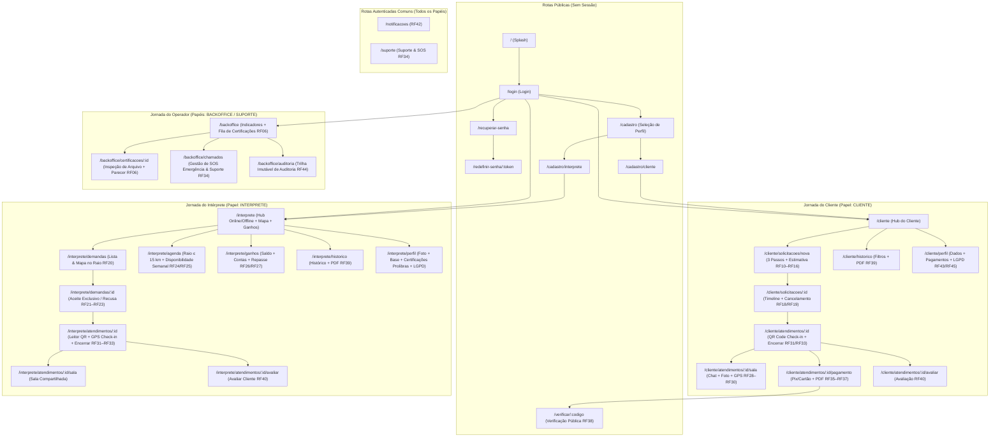
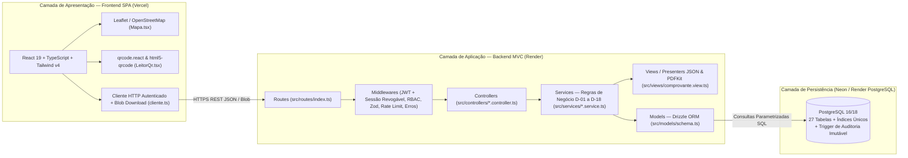
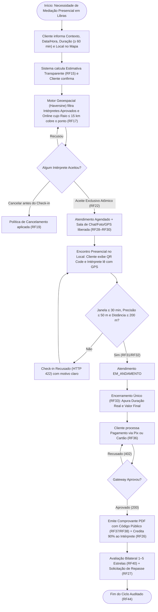
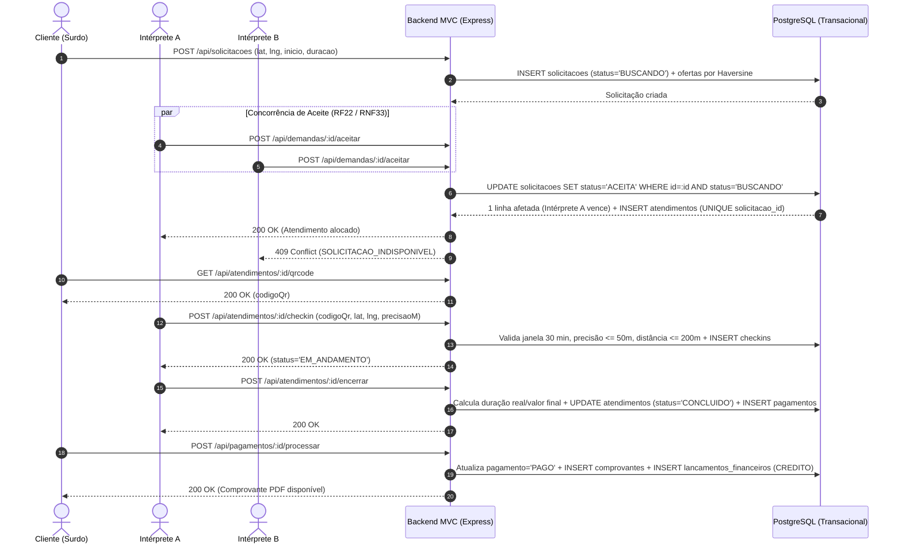
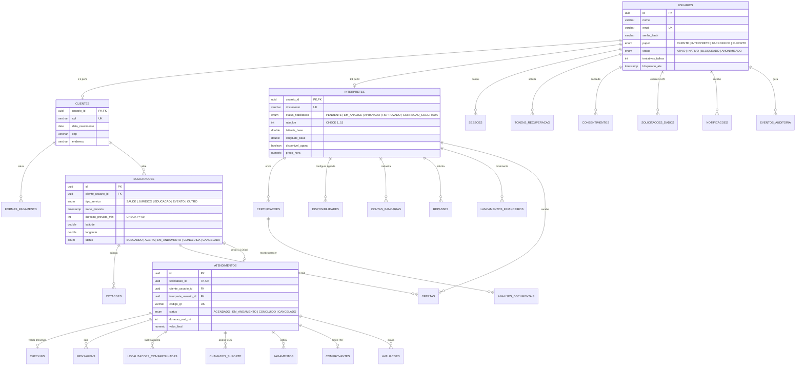

# Diagramas da Produção Técnica Gerados do Código Real (Bloco P1 — Itens #3, #7, #8, #9, #16, #17, #22, #24, #26)

> Fonte: Autoria própria apoiado por IA generativa — extraídos diretamente de `frontend/src/rotas.tsx`, `backend/src/models/schema.ts` e `backend/src/routes/index.ts`.

---

## 1. Sitemap Completo da Aplicação (Item #3 do Documento / #29 do Dossiê)

---

## 2. Arquitetura Funcional, Técnica e MVC (Itens #7, #8 e #9 do Documento)

---

## 3. Macroprocesso e Fluxograma do Atendimento Presencial (Itens #16 e #17)

---

## 4. Diagrama de Operação / Sequência — Aceite Exclusivo, Check-in e Pagamento (Item #24)

---

## 5. Diagrama Entidade-Relacionamento — DER de 27 Tabelas (Item #22 / #38 do Dossiê)

